# GPU architecture and Triton Basics

A beginner-friendly guide to GPU programming with the **Triton language**, using the **NVIDIA H100 SXM 80 GB** as the hardware reference. Follow the architectural progression **GPU hardware → CUDA software → Triton programming**.

First understand the GPU's compute and memory resources. Then learn the software hierarchy that runs on them. Finally, learn how Triton describes tensor operations as tiles and how its compiler maps that work onto the same hardware.

You only need basic Python and an understanding of arrays to read this guide. Running the examples requires a supported NVIDIA GPU and a working software installation. Compatible GPUs other than the H100 can run the basic kernels; their best tuning settings may differ.

The illustrations are original SVG diagrams stored in [docs/images](docs/images). They describe concepts rather than a physical chip floorplan. Performance calculations are estimates, not measured benchmarks.

## Contents

**[Part I: GPU hardware](#part-i-gpu-hardware)**

1. [GPU hardware overview](#1-gpu-hardware-overview)
2. [Hardware compute: SMs, warps, FP32 cores, and Tensor Cores](#2-hardware-compute-sms-warps-fp32-cores-and-tensor-cores)
3. [Hardware memory: registers, shared memory, L1, L2, and HBM](#3-hardware-memory-registers-shared-memory-l1-l2-and-hbm)

**[Part II: CUDA software](#part-ii-cuda-software)**

4. [CUDA software: host, kernels, grids, blocks, and threads](#4-cuda-software-host-kernels-grids-blocks-and-threads)
5. [CUDA execution and memory addressing](#5-cuda-execution-and-memory-addressing)

**[Part III: Triton programming](#part-iii-triton-programming)**

6. [Triton programs, tiles, and compiler mapping](#6-triton-programs-tiles-and-compiler-mapping)
7. [Essential Triton language building blocks](#7-essential-triton-language-building-blocks)
8. [Set up an environment](#8-set-up-an-environment)
9. [First complete kernel: vector addition](#9-first-complete-kernel-vector-addition)
10. [Memory access, strides, and broadcasting](#10-memory-access-strides-and-broadcasting)
11. [Reductions and fused softmax](#11-reductions-and-fused-softmax)
12. [Tiled matrix multiplication and Tensor Cores](#12-tiled-matrix-multiplication-and-tensor-cores)

**[Part IV: Performance, correctness, and practice](#part-iv-performance-correctness-and-practice)**

13. [Memory-bound versus compute-bound kernels](#13-memory-bound-versus-compute-bound-kernels)
14. [Occupancy and tuning on the H100](#14-occupancy-and-tuning-on-the-h100)
15. [How to measure performance](#15-how-to-measure-performance)
16. [Correctness, debugging, and common mistakes](#16-correctness-debugging-and-common-mistakes)
17. [Practice path and quick reference](#17-practice-path-and-quick-reference)
18. [Official documentation and further reading](#18-official-documentation-and-further-reading)

## Part I: GPU hardware

Understand the physical compute units and memory before learning how a program requests work from them. A warp connects the two layers: it is a group of execution contexts that the hardware schedules, while CUDA gives those contexts their programming model.

### 1. GPU hardware overview

#### 1.1 Two questions describe the hardware

1. **Where does computation happen?** In streaming multiprocessors (SMs), using instruction schedulers and arithmetic units such as FP32 units and Tensor Cores.
2. **Where does data live?** In registers, shared memory, L1 and L2 caches, and the GPU's main memory, HBM on the H100.

```text
H100 GPU
  Compute: many SMs -> schedulers + arithmetic units
  Memory:  per-SM registers and L1/shared storage
           GPU-wide L2 cache
           HBM stacks beside the compute die
```

The GPU is designed for high throughput across many independent operations. Arithmetic capacity helps only when the memory system and instruction scheduling can supply useful work to the execution units.

#### 1.2 The H100 used throughout this guide

Use a **full NVIDIA H100 SXM 80 GB** as the reference. Other H100 variants differ: NVIDIA documents 132 active SMs for the SXM model and 114 for the PCIe model. Multi-Instance GPU (MIG) partitions expose only a subset of a full GPU's resources. [NVIDIA Hopper architecture overview](https://developer.nvidia.com/blog/nvidia-hopper-architecture-in-depth/)

| Physical resource or execution limit | H100 SXM reference | Hardware meaning |
| --- | --- | --- |
| Architecture / compute capability | Hopper / 9.0 | Identifies the instruction and hardware feature generation |
| Active SMs | 132 | Compute sites distributed across the GPU |
| FP32 arithmetic units | 128 per SM; 16,896 total | Units for ordinary 32-bit floating-point arithmetic |
| Fourth-generation Tensor Cores | 4 per SM; 528 total | Units for supported matrix multiply-accumulate operations |
| Main device memory | 80 GB HBM3 | Large external-to-die memory for data |
| Rated HBM bandwidth | 3.35 TB/s | Reference data-transfer rate for the GPU's memory system |
| L2 cache | 50 MB across the GPU | Cache accessible through the memory system by all SMs |
| Register file | 65,536 32-bit registers per SM | A finite pool of working-value storage |
| Combined L1 / shared-memory capacity | 256 KB per SM | On-chip capacity divided between these facilities |
| Shared-memory capacity | Up to 228 KB per SM | Maximum shared-memory portion of that combined capacity |
| Resident warp limit | 64 per SM | Maximum number of warp contexts resident on an SM |

Sources: [Hopper architecture overview](https://developer.nvidia.com/blog/nvidia-hopper-architecture-in-depth/), [Hopper tuning guide](https://docs.nvidia.com/cuda/hopper-tuning-guide/index.html), and [NVIDIA HGX hardware specifications](https://docs.nvidia.com/enterprise-reference-architectures/hgx-ai-factory-h100-h200-b200/latest/components.html). NVIDIA labels the on-chip capacities in KB/MB; register storage is exactly `65,536 × 4 = 262,144` bytes. The bandwidth figure uses decimal TB/s and is a rated value, not a measured result for the examples.

### 2. Hardware compute: SMs, warps, FP32 cores, and Tensor Cores

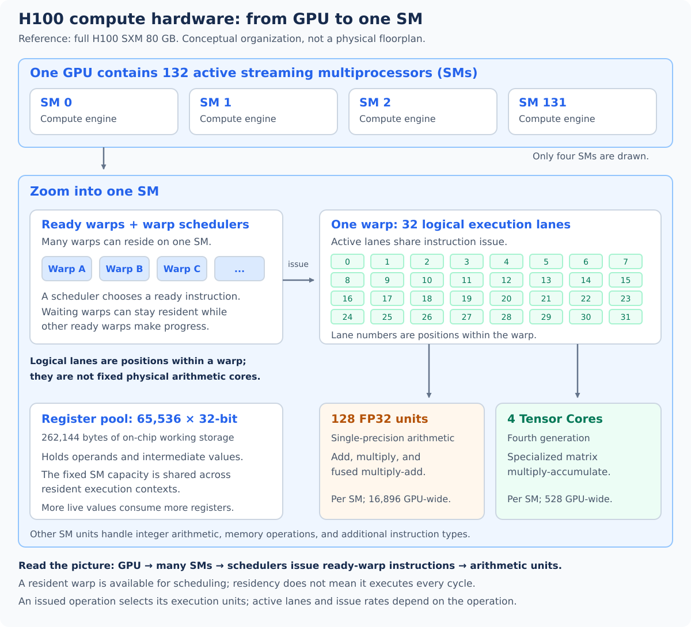

#### 2.1 SM: a compute site containing several resources

An **SM**, or streaming multiprocessor, is a physical part of the GPU. An SM contains scheduling machinery, arithmetic units, and on-chip storage. It can keep many execution contexts resident and share its resources among them.

| Component inside an SM | What it does |
| --- | --- |
| Warp schedulers | Select instructions from ready warps for issue |
| FP32 arithmetic units / CUDA cores | Perform supported scalar arithmetic, including floating-point addition and multiplication |
| Tensor Cores | Perform supported matrix multiply-accumulate operations |
| Other functional units | Handle other instruction types, such as integer, load/store, and special-function operations |
| Register file | Holds working values for resident execution contexts |
| L1 / shared-memory storage | Provides local caching and cooperative on-chip storage |

An SM is not one arithmetic core. It is the larger container that holds many execution resources.

#### 2.2 Warp: the hardware's group of 32 execution lanes

1. On NVIDIA GPUs, a **warp groups 32 thread contexts**. The software meaning of a thread is introduced in Part II; here, focus on the group the hardware schedules.
2. Each context has a **lane index**, from 0 to 31, identifying its position within the warp.
3. Instructions operate on participating lanes. The execution model is called **SIMT**, or single instruction, multiple threads.
4. The lanes can work on different values while applying an instruction from the same program.
5. A warp is an execution grouping, not a separate chip component containing 32 permanently dedicated arithmetic cores.

Conceptually, one addition instruction can apply to many participating lanes:

```text
lane 0:  a0 + b0
lane 1:  a1 + b1
...
lane 31: a31 + b31
```

This illustrates the work, not a guarantee that every lane maps to its own permanent FP32 unit or that every instruction finishes in one clock cycle. [CUDA warp execution model](https://docs.nvidia.com/cuda/cuda-programming-guide/01-introduction/programming-model.html#warps-and-simt)

#### 2.3 FP32 cores and Tensor Cores do different work

**FP32** means a 32-bit floating-point representation. An FP32 arithmetic unit performs operations on individual values. A Tensor Core performs supported small matrix multiply-accumulate operations.

| Property | FP32 arithmetic units / CUDA cores | Tensor Cores |
| --- | --- | --- |
| Basic kind of work | Arithmetic on individual values | Matrix multiply-accumulate |
| Illustrative expression | `c = a + b` or `c = a * b` | `D = A × B + C` for supported matrix operands |
| Common workloads | Elementwise arithmetic and general numerical work | Dense matrix products and related AI computations |
| H100 SXM units per SM | 128 FP32 units | 4 fourth-generation Tensor Cores |
| Requirement for effective use | Appropriate instructions and enough ready work | Supported matrix shapes, types, and instructions |

The hardware term **CUDA core** refers to an arithmetic unit, even though CUDA is also the name of the software platform. A software thread is a different concept. Tensor Cores do not automatically accelerate every operation performed on the GPU.

#### 2.4 Warp scheduling and latency hiding

1. An SM holds several resident warps, along with their working state.
2. A warp can be temporarily unable to proceed, for example while waiting for a memory load.
3. A scheduler can issue an instruction from another ready warp.
4. Overlapping independent work with waiting is called **latency hiding**.
5. The number of resident warps is limited by hardware capacity and the resources their work needs.

The H100 supports up to 64 resident warps per SM. Residency does not mean all 64 warps issue instructions simultaneously. More ready work creates opportunities to hide stalls; it does not remove dependencies or make data movement free.

#### 2.5 Inside one SM: four compute quadrants

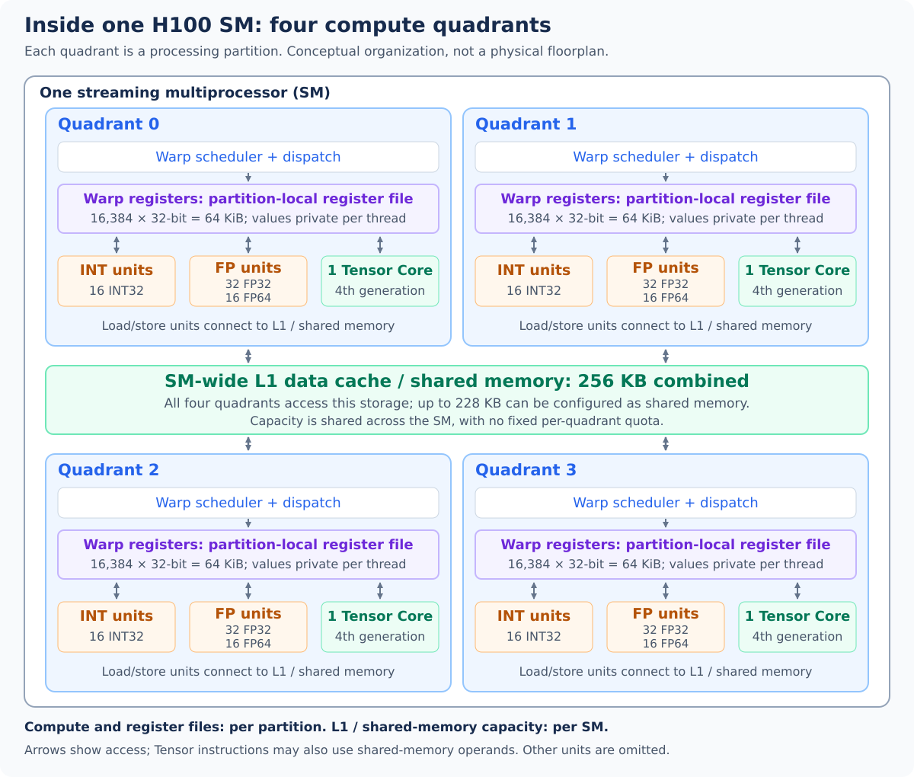

An H100 SM contains **four processing partitions**, drawn here as quadrants. Each has its own warp scheduler, register file, and execution units. All four connect to the same SM-wide L1/shared-memory subsystem. The quadrants show resource organization rather than a physical floorplan. [NVIDIA H100 SM architecture, Figure 4](https://developer.nvidia.com/blog/nvidia-hopper-architecture-in-depth/#h100-sm-architecture)

| Resource | Per quadrant / partition | Across one H100 SM |
| --- | --- | --- |
| Warp scheduler | 1, issuing instructions from ready warps | 4 |
| INT32 units | 16, for integer operations such as index arithmetic | 64 |
| FP32 units | 32, for single-precision arithmetic | 128 |
| FP64 units | 16, for double-precision arithmetic | 64 |
| Fourth-generation Tensor Core | 1, for supported matrix operations | 4 |
| Register file | 16,384 × 32-bit registers = 64 KiB | 65,536 × 32-bit registers = 256 KiB |
| Combined L1 / shared-memory storage | Access to the SM-wide resource | 256 KB combined; up to 228 KB for shared memory |

Compute and register counts follow [NVIDIA's H100 SM diagram](https://developer-blogs.nvidia.com/wp-content/uploads/2022/03/H100-Streaming-Multiprocessor-SM-625x869.png). Memory capacities follow the [Hopper tuning guide](https://docs.nvidia.com/cuda/hopper-tuning-guide/index.html#unified-shared-memory-l1-texture-cache).

**Compute division:** each scheduler issues ready-warp instructions to the appropriate execution pipeline. Integer instructions use INT units, floating-point instructions use FP units, and supported matrix instructions use Tensor Cores. Resident warps share those units over time; a warp does not own a permanent set of cores. The unit counts describe hardware resources, not a guarantee that every unit executes simultaneously.

**Register division:** each quadrant's register file holds the working values of its resident warps. INT, FP, and register-based Tensor operands or results use values from this file; there is no separate register pool for each arithmetic type. Registers remain logically private to each thread. A “warp's registers” means the allocations for its 32 threads, not variables automatically visible to every lane.

**Memory division:** L1/shared-memory capacity belongs to the whole SM; it is not divided into four fixed quadrant quotas. Warps of the same block can exchange values through that block's shared-memory allocation even when they use different quadrants, with appropriate synchronization. Sharing physical storage does not grant unrelated blocks access to each other's allocations. Register demand limits residency within partitions, while shared-memory demand consumes the SM-wide budget. See [CUDA memory scope](https://docs.nvidia.com/cuda/cuda-programming-guide/01-introduction/programming-model.html#gpu-memory) and [Hopper resource limits](https://docs.nvidia.com/cuda/hopper-tuning-guide/index.html#occupancy).

### 3. Hardware memory: registers, shared memory, L1, L2, and HBM

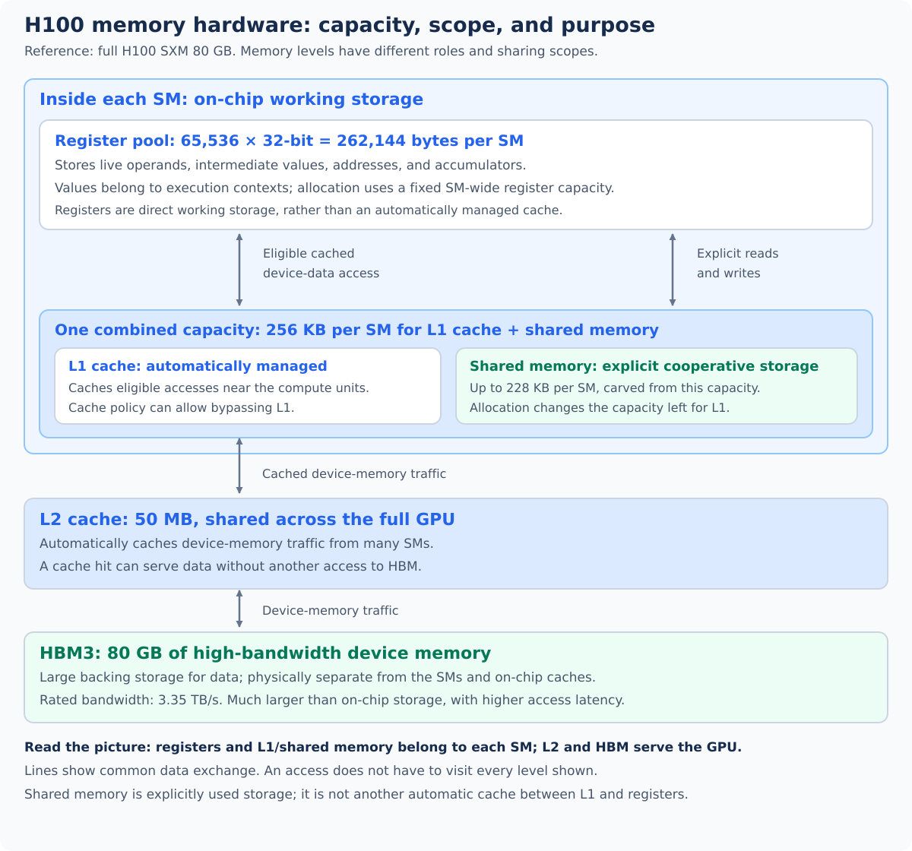

#### 3.1 Start near the compute units, then move outward

| Physical storage | Location / scope | Purpose | Main constraint |
| --- | --- | --- | --- |
| Registers | Register file inside each SM | Hold working values close to arithmetic units | Limited capacity shared by resident work |
| Shared memory | On-chip storage inside an SM | Cooperative storage controlled by program instructions | Capacity, access patterns, and coordination |
| L1 cache | Inside each SM | Automatically cache eligible data accesses near compute | Finite capacity; allocation shares resources with shared memory |
| L2 cache | On the GPU die, shared across SMs | Reuse data without another HBM access | Finite capacity and workload-dependent hit rate |
| HBM3 | Memory stacks beside the compute die | Store large data arrays | Longer access latency and finite bandwidth compared with on-chip working storage |

HBM means **high-bandwidth memory**. Its large capacity makes it suitable for arrays that cannot fit in the small on-chip memories. On the H100 SXM, it is HBM3; other GPU models may use another HBM generation or GDDR.

The H100's total register capacity is distributed across four partition-local register files, as shown in Section 2.5. Values belong logically to individual execution contexts; the per-SM total does not mean every warp can draw freely from every partition's registers.

#### 3.2 L1 cache and shared memory share capacity, not behavior

- **L1 is a cache:** hardware retains eligible accessed data automatically.
- **Shared memory is cooperative storage:** instructions deliberately place and access values there.
- H100 provides 256 KB of combined L1/shared-memory capacity per SM.
- Up to 228 KB can be used as shared memory. These are not two independent pools of 256 KB and 228 KB.
- A configuration that dedicates more capacity to shared memory changes the capacity available for caching and other uses of the combined resource. [Hopper on-chip memory configuration](https://docs.nvidia.com/cuda/hopper-tuning-guide/index.html#unified-shared-memory-l1-texture-cache)

#### 3.3 A load can be served at different levels

1. A request for device-memory data can be satisfied by an eligible L1 cache hit.
2. If needed, the request can reach L2.
3. If the requested data is not cached, the memory system fetches it from HBM.
4. Loaded working values can then be used through registers by arithmetic instructions.
5. Shared memory is a separate destination for cooperative staging; it is not a mandatory hop between L1 and registers.

Cache policies can bypass L1. The diagram shows conceptual connections rather than one required path for every instruction. Software **global** and **local** address spaces are introduced in Part II; they should not be confused with these physical storage components.

#### 3.4 Bandwidth, latency, and reuse

| Term | Plain-language meaning | Why it matters |
| --- | --- | --- |
| Bandwidth | Amount of data moved per second | Limits sustained transfers of large arrays |
| Latency | Time from requesting data to receiving it | Can make execution wait unless independent work overlaps it |
| Reuse | Use a loaded value again before discarding it | Reduces repeated transfers from farther-away memory |

The H100's rated 3.35 TB/s refers to its HBM memory system, not CPU-to-GPU transfer bandwidth. Reducing repeated HBM accesses can be as valuable as increasing the amount of arithmetic performed. There is no single fixed latency number that applies to all loads, cache states, and access patterns.

## Part II: CUDA software

Now connect the hardware to the software objects a GPU program creates. SMs and memories are hardware resources; kernels, grids, blocks, and threads describe how software organizes work.

### 4. CUDA software: host, kernels, grids, blocks, and threads

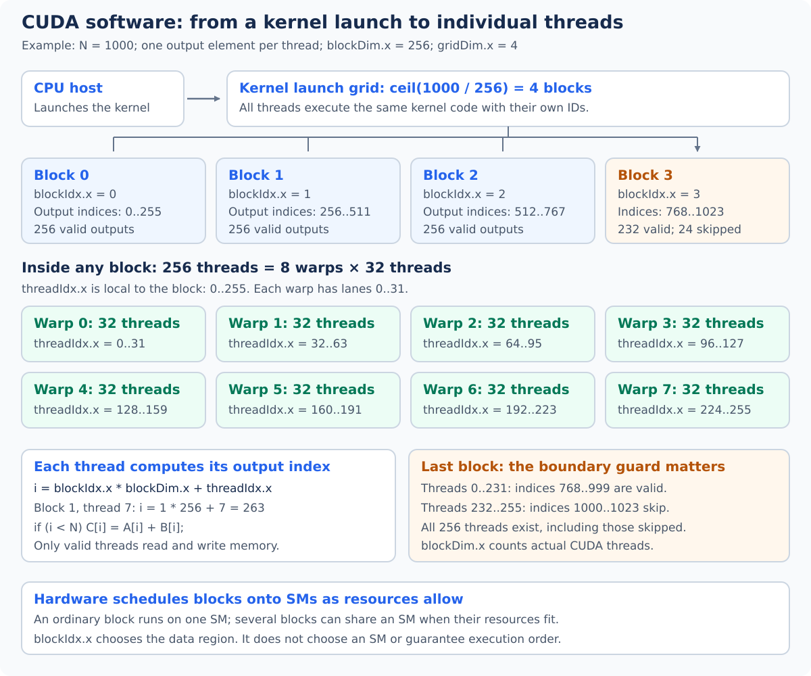

#### 4.1 Host, device, and kernel

1. **Host:** CPU-side code prepares data, manages allocations, and requests GPU work.
2. **Device:** the GPU and its device memory execute that work.
3. **Kernel:** a function compiled to run on the GPU, with many execution contexts running its body over different data.
4. **Kernel launch:** the host enqueues that function with a chosen configuration.

For vector addition, the same kernel logic computes `C[i] = A[i] + B[i]`; different threads can choose different `i` values.

#### 4.2 Grid, block, thread, and warp

```text
One kernel launch
  -> one grid of thread blocks
       -> each block contains threads
            -> threads are grouped into warps of 32
```

| Software concept | What it means | Connection to the hardware |
| --- | --- | --- |
| Grid | All thread blocks in one launch | Work distributed across available SMs |
| Thread block / CTA | A group of cooperating threads | An ordinary block executes on one SM |
| Thread | One execution context with its own working state | Uses registers and shares execution resources |
| Warp | A group of 32 threads from a block | The execution group introduced in the hardware chapter |

CTA means **cooperative thread array**, another name for a CUDA thread block. Grids and blocks may have one, two, or three logical dimensions. Start with a one-dimensional launch before using multidimensional indexing. [CUDA blocks and grids](https://docs.nvidia.com/cuda/cuda-programming-guide/01-introduction/programming-model.html#thread-blocks-and-grids)

#### 4.3 A software thread is not an FP32 core

- A thread has a programming identity and working state.
- An FP32 core is a physical arithmetic unit used when suitable instructions execute.
- Many resident threads share the SM's units over time.
- A thread can calculate multiple output elements, and some instructions use units other than FP32 arithmetic units.
- The H100's 16,896 FP32 units do not limit a launch to 16,896 software threads.

#### 4.4 Conventional CUDA indexing, one element per thread

The following is an indexing example, not a complete executable CUDA program:

```text
threadIdx.x = this thread's index within its block
blockIdx.x  = this block's index within the launch grid
blockDim.x  = threads per block
gridDim.x   = number of blocks

i = blockIdx.x * blockDim.x + threadIdx.x
if i < N:
    C[i] = A[i] + B[i]
```

With `N=1000` and `blockDim.x=256`, choose `ceil(1000/256)=4` blocks. Each block has 256 threads, or eight warps.

| Block index | Thread indices inside the block | Candidate output indices | Useful output indices |
| --- | --- | --- | --- |
| 0 | 0–255 | 0–255 | 0–255 |
| 1 | 0–255 | 256–511 | 256–511 |
| 2 | 0–255 | 512–767 | 512–767 |
| 3 | 0–255 | 768–1023 | 768–999 |

The final 24 threads skip the addition because `i >= N`. One element per thread is a choice in this example, not a CUDA requirement.

### 5. CUDA execution and memory addressing

#### 5.1 How blocks reach SMs

1. The launch creates a grid of blocks; its size can exceed the number of SMs.
2. Hardware assigns an ordinary block to an SM with sufficient resources.
3. Several blocks can reside on one SM if their register, shared-memory, and thread requirements fit.
4. Warps from those blocks provide ready instructions for the SM's schedulers.
5. When blocks finish, more blocks can be admitted.

`blockIdx.x=0` does not select SM 0. Block execution order and physical placement are not guaranteed. A grid of four blocks also does not use all 132 H100 SMs.

#### 5.2 Cooperation, synchronization, and divergence

- Threads in a block can cooperate using shared memory and appropriate synchronization.
- A block-wide barrier can coordinate its participating threads; it is not a barrier across the entire grid.
- Ordinary blocks should be able to run in any order. Do not assume one block has already produced a result needed by another.
- A later kernel in the same CUDA stream can establish a straightforward global phase boundary.
- If lanes in a warp take different control-flow paths, some lanes are inactive for portions of execution. This is called **divergence**.
- Hopper also supports advanced thread-block clusters for additional cooperation. The basic examples here use ordinary independent blocks.

#### 5.3 Software memory names versus physical storage

| Software view | Meaning | Physical relationship |
| --- | --- | --- |
| Global memory | Addresses accessible to threads across the GPU | Typically device HBM allocations, with accesses served through eligible caches |
| Shared memory | Storage shared by threads in an ordinary block | Uses the SM's shared-memory allocation |
| Thread-local values | Variables private to one thread | Commonly held in registers when the compiler can allocate them there |
| Local memory | A thread-private address space | Backed by device memory; may hold spilled values or certain local arrays |
| Host memory | CPU-side storage | Separate from ordinary device allocations in these examples |

**HBM is a physical memory technology; global memory is a programming address space.** Similarly, “local memory” describes visibility, not proximity or speed. When register pressure causes values to spill, the extra accesses can reach device memory and caches. [CUDA memory model](https://docs.nvidia.com/cuda/cuda-programming-guide/01-introduction/programming-model.html#gpu-memory)

The H100 permits up to 227 KB of shared memory for a single block, within its per-SM shared-memory limit. The exact allocation and residency of compiled kernels depend on their resource requirements. [Hopper shared-memory limits](https://docs.nvidia.com/cuda/hopper-tuning-guide/index.html)

#### 5.4 The software stack above the hardware

```text
Host application, for example Python / PyTorch
  -> prepares tensors and requests an operation
GPU kernel code, written in CUDA or Triton
  -> describes the GPU computation
Compiler
  -> lowers the computation to target instructions / device code
GPU runtime and driver
  -> manage device execution and launch work
Hardware
  -> schedules work on SMs and uses the compute and memory units
```

CUDA and Triton are ways to describe GPU work. They ultimately use the same SMs, warp execution machinery, registers, caches, and HBM; choosing a different language does not replace those resources.

## Part III: Triton programming

Triton changes the level at which you describe the work. With the hardware and CUDA thread model established, begin with logical tensor tiles and then connect them back to blocks, warps, and threads.

### 6. Triton programs, tiles, and compiler mapping

#### 6.1 Kernel, program instance, and tile are different concepts

Triton is a Python-based language and compiler for writing GPU kernels. `@triton.jit` marks GPU code; ordinary Python around it allocates tensors and launches work.

| Triton concept | Meaning |
| --- | --- |
| Kernel | The compiled GPU function defining the operation |
| Program grid | Coordinates of all program instances requested by a launch |
| Program instance | One invocation of the kernel body at a program-grid coordinate |
| Logical tile | A collection of tensor elements operated on together inside a program |
| Compiler layout | The mapping that distributes logical values over threads, warps, and registers |

This is SPMD: **single program, multiple data**. Instances run the same kernel body with different program IDs and usually different data regions. A program can manipulate several tiles and can loop over multiple data regions. A tile is data, not an execution context. [Triton JIT API](https://triton-lang.org/main/python-api/generated/triton.jit.html), [Triton language API](https://triton-lang.org/main/python-api/triton.language.html)

#### 6.2 Tiling: divide data into useful pieces

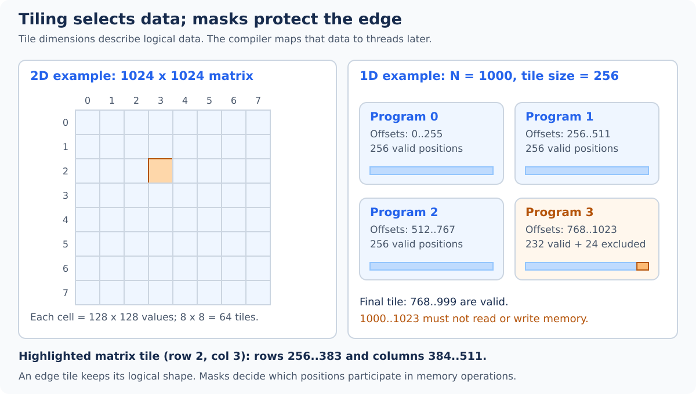

1. For a vector, a tile might contain 256 consecutive values.
2. For a matrix, a tile might contain 128 rows by 128 columns.
3. A `1024 × 1024` matrix divided into `128 × 128` tiles gives `8 × 8 = 64` tiles.
4. A program can own one output tile while loading several input tiles to compute it.
5. Tiling can improve reuse in registers, shared memory, and caches. The benefit depends on the operation and the chosen tile shape.

```text
1024 x 1024 matrix
  / 128 x 128 output tile
  = 8 tile rows x 8 tile columns
  = 64 logical output tiles
```

For matrix multiplication, repeatedly loading input tiles along the reduction dimension lets one output tile accumulate many contributions. Section 12 works through that algorithm.

Read the diagram using zero-based coordinates:

- Matrix tile `(2, 3)` starts at row `2 × 128 = 256` and column `3 × 128 = 384`.
- It covers rows 256–383 and columns 384–511. These are data positions, independent of how many threads cooperate on them.
- In the separate vector example, four 256-position tiles cover 1,000 elements. The last tile has 232 valid positions and 24 positions outside the array.
- The last tile keeps its logical size. A **mask** disables memory operations for the 24 invalid positions; Section 7 shows the code.

#### 6.3 Describe the tile's work

1. **Choose ownership:** specify which outputs each program produces.
2. **Choose tile shapes:** decide how much logical data to operate on at a time.
3. **Get the program ID:** choose this invocation's data region.
4. **Build pointers and masks:** calculate addresses and guard boundaries.
5. **Load → compute → store:** express operations on logical tensor values.
6. **Let the compiler distribute the work:** layouts and lowering map those operations onto GPU execution resources.

A normal Python loop might describe one element at a time:

```python
for i in range(n):
    c[i] = a[i] + b[i]
```

Triton expresses operations over a tile. The GPU runs compiled device code; it does not execute the Python interpreter for each element.

#### 6.4 CUDA versus Triton, after learning both layers

| Question | Conventional CUDA thread programming | Standard Triton tile programming |
| --- | --- | --- |
| What does the kernel body primarily describe? | Work done by an individual thread | Operations on logical tensors / tiles |
| How is parallel work organized? | Grid of thread blocks | Grid of program instances |
| How is a data region selected? | Often `blockIdx` and `threadIdx` arithmetic | Often `tl.program_id` and logical offsets from `tl.arange` |
| Who distributes tile elements among threads? | Often the programmer | Mostly the compiler through its layouts |
| Who manages cooperative staging? | Often explicit shared-memory code | Often compiler-generated staging and communication |
| What still needs programmer decisions? | Algorithm, addresses, synchronization, and launch configuration | Algorithm, tile ownership/shapes, addresses, masks, and tuning parameters |

`tl.arange` generates logical element positions; it is not a replacement name for `threadIdx`. CUDA also has tile-oriented APIs, but this comparison uses conventional thread-oriented CUDA to explain Triton's abstraction.

#### 6.5 Map a Triton launch back to CUDA and hardware

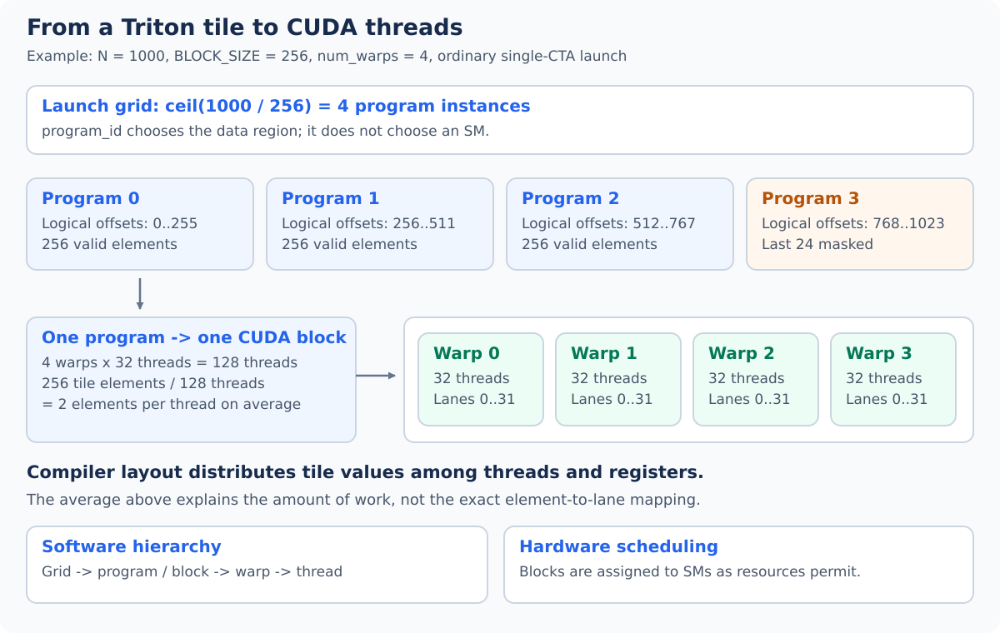

For the ordinary **single-CTA** launches used here, one Triton program maps to one CUDA thread block. Advanced cluster configurations can use multiple CTAs and are outside this basic correspondence. [Triton launch configuration](https://triton-lang.org/main/python-api/generated/triton.Config.html)

```text
Triton grid -> program instance -> operations on logical tiles
                                 compiler layout distributes values
CUDA       -> ordinary block -> warps -> threads
Hardware   -> SM schedules those warps using arithmetic and memory units
```

For vector addition:

```text
N = 1000                   total useful elements
BLOCK_SIZE = 256           logical elements per program
grid = ceil(1000 / 256)     4 program instances
num_warps = 4              4 warps per ordinary program / block
threads per block = 4*32    128 CUDA threads
```

- `BLOCK_SIZE=256` describes **data**, not 256 threads.
- `num_warps=4` specifies four warps for this basic configuration.
- The 256 logical values are distributed over 128 threads: two elements per thread on average for this tile.
- Exact ownership depends on the compiler layout; lane `i` need not own only element `i`.
- Four program instances create four ordinary blocks here. Hardware chooses where and when they run.
- Compare with Section 4's CUDA example: it deliberately used 256 threads per block and one output per thread. The data coverage is the same; the work mapping differs.

#### 6.6 What the programmer chooses and what the compiler handles

| You specify | The compiler/runtime handles |
| --- | --- |
| Output ownership and tile shapes | Distribution of tile values over threads |
| Pointer arithmetic and masks | Instructions implementing memory operations |
| Elementwise operations, reductions, and matrix products | Supported arithmetic instructions and communication needed by those operations |
| Warp and eligible pipeline settings | Register allocation and eligible staging/pipelining |
| Data types and precision requirements | Lowering to suitable target instructions |

Hardware schedules the resulting blocks onto SMs. The compiler still needs a good algorithm and access pattern; it cannot eliminate unnecessary data movement that the algorithm requires.

#### 6.7 Connect loads and fusion to the hardware memory model

1. `tl.load` reads addresses described by pointers and produces a logical tensor of values.
2. Simple elementwise values are commonly distributed into registers by the compiler.
3. A load does not guarantee the entire tile is staged in shared memory; caches, registers, and cooperative staging have distinct roles.
4. Keeping intermediate results inside one kernel can avoid storing and rereading intermediate global tensors.
5. This is **fusion**. For example, `y = relu(x + bias)` can combine a load, addition, ReLU, and final store.
6. Larger fused computations can require more registers, so measure the result instead of assuming fusion always improves performance.

### 7. Essential Triton language building blocks

#### 7.1 The API in plain language

Host code uses `triton`; kernel code mainly uses `triton.language`, conventionally imported as `tl`.

| Construct | Meaning | Typical use |
| --- | --- | --- |
| `@triton.jit` | Compile a restricted Python function as GPU code | Define a kernel or GPU helper |
| `tl.constexpr` | Mark a parameter as known at compile time | Tile dimensions and compile-time choices |
| `tl.program_id(axis=0)` | This program's coordinate on a grid axis | Select a vector tile or output-matrix tile |
| `tl.arange(0, BLOCK_SIZE)` | Logical offsets `0` through `BLOCK_SIZE - 1` | Generate positions within a tile |
| `tl.load(ptrs, mask=valid, other=0)` | Read valid addresses; supply a value for masked positions | Handle the final incomplete tile |
| `tl.store(ptrs, values, mask=valid)` | Write only valid positions | Protect output boundaries |
| `tl.sum(values, axis=0)` | Reduce one logical tensor dimension | Row sum or normalization |
| `tl.max(values, axis=0)` | Maximum along a logical dimension | Stable softmax |
| `tl.exp(values)` | Elementwise exponential | Softmax numerators |
| `tl.dot(a, b, acc)` | Matrix product added to an accumulator | Tiled matrix multiplication |
| `values.to(tl.float32)` | Convert values to another type | Compute low-precision inputs in FP32 |
| `triton.cdiv(n, block)` | Host-side ceiling division | Count tiles that cover all elements |
| `triton.next_power_of_2(n)` | Host-side power-of-two rounding | Pad a logical reduction tile |
| `kernel[grid](...)` | Launch the compiled kernel | Enqueue GPU work from Python |

Reference: [Triton language API](https://triton-lang.org/main/python-api/triton.language.html).

#### 7.2 Compile-time constants

For the `tl.arange(0, BLOCK_SIZE)` pattern, use a positive power-of-two block size, such as 128, 256, or 512, known at compile time. The input length can still be any nonnegative integer; a mask handles the tail. [Triton `arange` API](https://triton-lang.org/main/python-api/generated/triton.language.arange.html)

- `BLOCK_SIZE: tl.constexpr` lets the compiler know the logical shape.
- Changing it can compile a new specialization of the kernel.
- The name `BLOCK_SIZE` is a convention, not a special built-in variable.
- A runtime dimension such as `n_elements` controls validity without necessarily determining the tile's compile-time shape.

#### 7.3 Pointer arithmetic is in elements

Suppose `X` points to FP32 data:

```text
X + 0 -> first element
X + 1 -> next element, 4 bytes later
X + 8 -> element eight, 32 bytes later
```

Do not multiply offsets by the dtype's byte size when forming a typed Triton pointer. The element type already determines the byte scaling.

#### 7.4 Masks belong on memory operations

For `N=1000` and `BLOCK_SIZE=256`, program 3 creates offsets 768–1023. Only 768–999 are valid.

```python
# Fragment inside a @triton.jit kernel.
offsets = tl.program_id(0) * BLOCK_SIZE + tl.arange(0, BLOCK_SIZE)
valid = offsets < n_elements
x = tl.load(X + offsets, mask=valid, other=0.0)
tl.store(Y + offsets, x, mask=valid)
```

1. The load mask prevents invalid memory reads.
2. `other=0.0` supplies a defined value for excluded positions.
3. The store mask prevents invalid writes.
4. Masking only the store does not protect an earlier unmasked load.
5. `tl.where` selects values, but both value expressions are evaluated; it cannot replace a mask guarding an unsafe load. [Load API](https://triton-lang.org/main/python-api/generated/triton.language.load.html), [store API](https://triton-lang.org/main/python-api/generated/triton.language.store.html), [where API](https://triton-lang.org/main/python-api/generated/triton.language.where.html)

### 8. Set up an environment

#### 8.1 Requirements

- A Linux environment supported by the Triton and PyTorch releases you choose.
- A supported Python version for those releases.
- A compatible NVIDIA GPU and working NVIDIA driver. The H100 should report compute capability `(9, 0)`.
- CUDA-enabled PyTorch for tensor allocation and comparison, plus a compatible Triton installation.

Create an isolated environment:

```bash
python3 -m venv .venv
source .venv/bin/activate
python -m pip install --upgrade pip
```

Install CUDA-enabled PyTorch using the command supplied by the [official PyTorch installation selector](https://pytorch.org/get-started/locally/) for your platform and driver. Supported Linux NVIDIA PyTorch wheels normally install their compatible Triton dependency. Check the imports below before independently changing that dependency. For standalone Triton installation details, consult the [official Triton installation guide](https://triton-lang.org/main/getting-started/installation.html).

#### 8.2 Check the GPU and package versions

First run `nvidia-smi` in the terminal. Then run this Python code:

```python
import torch
import triton

print("PyTorch:", torch.__version__)
print("Triton:", triton.__version__)
print("PyTorch CUDA build:", torch.version.cuda)
if not torch.cuda.is_available():
    raise RuntimeError("A working CUDA GPU is required for these examples.")

device = torch.cuda.current_device()
props = torch.cuda.get_device_properties(device)
print("GPU:", props.name)
print("Compute capability:", torch.cuda.get_device_capability(device))
print("SM count:", props.multi_processor_count)
print("Visible memory (GiB):", props.total_memory / 2**30)
```

The CUDA version displayed by `nvidia-smi` describes driver compatibility; it is not necessarily your installed toolkit or PyTorch build version. Record the actual visible GPU resources, especially when using MIG.

### 9. First complete kernel: vector addition

#### 9.1 Goal and ownership

Compute `C[i] = A[i] + B[i]` for two contiguous, one-dimensional FP32 CUDA tensors. Each program owns one consecutive output tile.

| Program ID | Logical offsets with `BLOCK_SIZE=256` | Valid offsets for `N=1000` |
| --- | --- | --- |
| 0 | 0–255 | 0–255 |
| 1 | 256–511 | 256–511 |
| 2 | 512–767 | 512–767 |
| 3 | 768–1023 | 768–999 |

#### 9.2 Complete example

Save this block as `vector_add.py` and run `python vector_add.py` in your GPU environment. It includes boundary-size correctness checks; it is a forward computation without an autograd registration.

```python
import torch
import triton
import triton.language as tl


@triton.jit
def add_kernel(A, B, C, n_elements, BLOCK_SIZE: tl.constexpr):
    pid = tl.program_id(axis=0)
    offsets = pid * BLOCK_SIZE + tl.arange(0, BLOCK_SIZE)
    valid = offsets < n_elements
    a = tl.load(A + offsets, mask=valid, other=0.0)
    b = tl.load(B + offsets, mask=valid, other=0.0)
    tl.store(C + offsets, a + b, mask=valid)


def add(a, b, block_size=256):
    if not (a.is_cuda and b.is_cuda and a.device == b.device):
        raise ValueError("Inputs must be CUDA tensors on the same device.")
    if a.ndim != 1 or b.shape != a.shape:
        raise ValueError("Inputs must be vectors with identical shapes.")
    if a.dtype != torch.float32 or b.dtype != torch.float32:
        raise ValueError("This example accepts FP32 inputs.")
    if not (a.is_contiguous() and b.is_contiguous()):
        raise ValueError("Inputs must be contiguous.")
    if block_size not in (128, 256, 512, 1024):
        raise ValueError("Choose block_size from 128, 256, 512, or 1024.")

    c = torch.empty_like(a)
    n = a.numel()
    if n == 0:
        return c  # No work and no zero-sized grid launch.

    grid = (triton.cdiv(n, block_size),)
    with torch.cuda.device(a.device):
        add_kernel[grid](a, b, c, n, BLOCK_SIZE=block_size, num_warps=4)
    return c


if __name__ == "__main__":
    if not torch.cuda.is_available():
        raise RuntimeError("A working CUDA GPU is required.")
    torch.manual_seed(0)
    for n in (0, 1, 255, 256, 257, 1000, 4097):
        a = torch.randn(n, device="cuda", dtype=torch.float32)
        b = torch.randn_like(a)
        torch.testing.assert_close(add(a, b), a + b, rtol=1e-6, atol=1e-6)
    print("Vector-add boundary checks passed.")
```

#### 9.3 Connect each step to hardware

1. **`torch.empty_like`:** allocates the output tensor in device memory.
2. **`triton.cdiv`:** counts the tiles needed; ceiling division includes a partial final tile.
3. **`tl.program_id`:** gives each program a distinct tile, avoiding overlapping writes.
4. **`tl.arange`:** describes tile positions; these positions are not CUDA thread IDs.
5. **`tl.load`:** creates tile values from input addresses, using the GPU memory system.
6. **`a + b`:** performs elementwise arithmetic over the logical tile, distributed across threads.
7. **`tl.store`:** writes only valid outputs back to device memory.
8. **`num_warps=4`:** uses four warps per ordinary program. It is an illustrative starting point, not a claim of best H100 performance.

The Python wrapper returns after enqueueing work. Operations in the same stream observe the required order. Synchronization is needed when the host must wait for completion, and proper GPU timing must account for this asynchronous execution.

### 10. Memory access, strides, and broadcasting

#### 10.1 Coalescing: request nearby addresses together

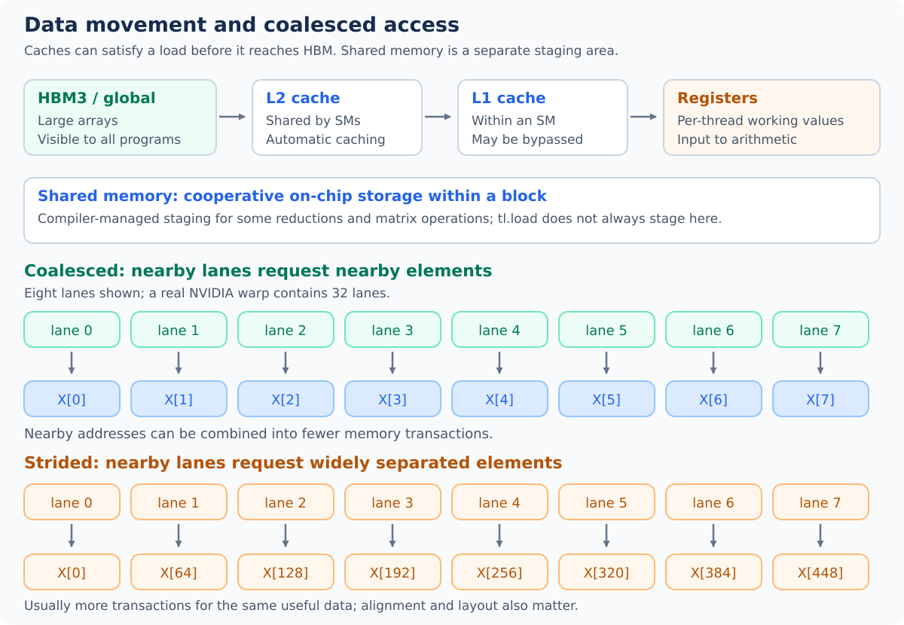

Memory hardware combines suitable accesses from a warp into transactions. **Coalesced access** means participating lanes request addresses that can be served efficiently together.

- Consecutive vector offsets give the compiler a useful starting pattern.
- Widely spaced offsets can require more transactions for the same useful number of elements.
- Alignment, dtype, and the compiler's thread layout affect the actual transaction count.
- A contiguous tensor is helpful, but a poor lane-to-address mapping can still waste bandwidth.
- Coalescing improves a group of accesses; caching improves reuse across accesses. These are different mechanisms. [CUDA coalescing guidance](https://docs.nvidia.com/cuda/cuda-c-best-practices-guide/index.html#coalesced-access-to-global-memory)

#### 10.2 Strides explain multidimensional addressing

For a 2D tensor, strides give the number of **elements** to move along each dimension:

```text
address of X[row, col] = X + row * stride_row + col * stride_col

Contiguous shape (3, 5): stride_row = 5, stride_col = 1
X[2, 3]: element offset = 2*5 + 3*1 = 13
```

A transpose changes the logical strides. Assuming `row * n_cols + col` for every tensor can produce incorrect results on views. Either enforce contiguous inputs, as the examples do, or pass and use the actual strides. [Triton matrix pointer arithmetic](https://triton-lang.org/main/getting-started/tutorials/03-matrix-multiplication.html#pointer-arithmetic)

#### 10.3 Broadcasting constructs a 2D tile

```python
# Fragment inside a @triton.jit kernel; BM and BN are compile-time sizes.
rows = tl.program_id(0) * BM + tl.arange(0, BM)
cols = tl.program_id(1) * BN + tl.arange(0, BN)
ptrs = X + rows[:, None] * stride_row + cols[None, :] * stride_col
valid = (rows[:, None] < n_rows) & (cols[None, :] < n_cols)
tile = tl.load(ptrs, mask=valid, other=0.0)
```

1. `rows` has shape `[BM]`; `rows[:, None]` has shape `[BM, 1]`.
2. `cols[None, :]` has shape `[1, BN]`.
3. Broadcasting combines the row and column offsets into shape `[BM, BN]`.
4. The mask has that same logical shape and protects both dimensions.
5. Broadcasting describes values and addresses; it does not allocate a host NumPy array or launch another kernel.

### 11. Reductions and fused softmax

#### 11.1 A reduction combines values

An elementwise addition produces one output per element. A reduction combines many values into fewer outputs.

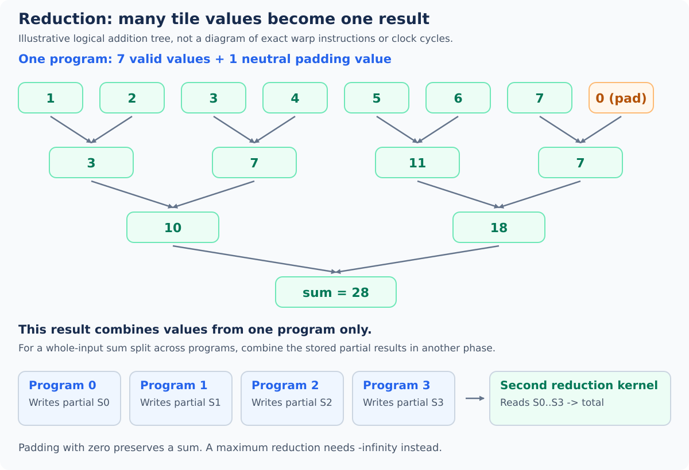

- `tl.sum(x, axis=0)` sums along a logical tensor dimension.
- `tl.max(x, axis=0)` finds its maximum.
- For a logical vector, axis 0 reduces the vector to a scalar.
- For a logical `[BM, BN]` tile, axis 1 reduces columns and leaves one result per row.
- **Reduction axes describe the logical tile, not launch-grid axes.**

The compiler arranges the thread communication needed for a reduction; this may include warp instructions and shared memory. A reduction only combines values within the current program's logical tensor. Combining results across programs requires a separate design, such as a second reduction kernel. [Sum API](https://triton-lang.org/main/python-api/generated/triton.language.sum.html), [max API](https://triton-lang.org/main/python-api/generated/triton.language.max.html)

Walk through the sum in the picture:

1. Start with seven values, `[1, 2, 3, 4, 5, 6, 7]`, and pad an eight-position tile with zero.
2. Illustrative pairwise additions produce `[3, 7, 11, 7]`, then `[10, 18]`, then `28`.
3. Independent partial additions can proceed in parallel, reducing the need for a single long dependency chain.
4. The tree explains the operation; the compiler chooses the actual communication and instruction sequence. Floating-point results can vary with reduction order.
5. If four programs each reduce a different input tile, they produce four partial results. A second reduction phase can combine those partials into a whole-input sum.

#### 11.2 Use padding values that preserve the result

| Operation | Value for masked input positions | Reason |
| --- | --- | --- |
| Sum | `0` | Adding zero leaves a sum unchanged |
| Product | `1` | Multiplying by one leaves a product unchanged |
| Maximum | `-inf` | Cannot exceed any finite valid value |
| Minimum | `+inf` | Cannot fall below any finite valid value |

For example, padding `[-5, -2, -7]` with zero would make its maximum incorrect. Padding with `-inf` preserves `-2`.

#### 11.3 Stable row softmax

Softmax turns a row of scores into positive weights that sum approximately to one:

```text
row_max = max(x)
numerator[i] = exp(x[i] - row_max)
output[i] = numerator[i] / sum(numerator)
```

1. Subtracting the maximum avoids unnecessarily large exponentials for finite inputs.
2. Each program loads one row and performs both reductions locally.
3. Padding with `-inf` makes padded numerators zero after exponentiation.
4. The kernel stores the final row without writing intermediate rows to global memory.
5. Triton's exponential and floating-point reductions can differ slightly from the reference; compare with a suitable tolerance. [Official fused softmax tutorial](https://triton-lang.org/main/getting-started/tutorials/02-fused-softmax.html)

#### 11.4 Complete teaching example

Save as `row_softmax.py`. This simple version accepts contiguous FP32 matrices with **finite values** and 1–4,096 columns. It handles one row per program. The width limit keeps the teaching example bounded; it is not a hardware limit or a production tuning recommendation. NaNs and infinities require an explicitly chosen policy beyond this example.

```python
import torch
import triton
import triton.language as tl


@triton.jit
def row_softmax_kernel(X, Y, n_cols, stride_xr, stride_yr,
                       BLOCK_SIZE: tl.constexpr):
    row_id = tl.program_id(0)
    cols = tl.arange(0, BLOCK_SIZE)
    valid = cols < n_cols
    x = tl.load(X + row_id * stride_xr + cols,
                mask=valid, other=-float("inf"))
    shifted = x - tl.max(x, axis=0)
    numerator = tl.exp(shifted)
    y = numerator / tl.sum(numerator, axis=0)
    tl.store(Y + row_id * stride_yr + cols, y, mask=valid)


def row_softmax(x):
    if not x.is_cuda or x.ndim != 2 or x.dtype != torch.float32:
        raise ValueError("Expected a 2D FP32 CUDA tensor.")
    if not x.is_contiguous():
        raise ValueError("This example requires contiguous input.")
    n_rows, n_cols = x.shape
    if not 1 <= n_cols <= 4096:
        raise ValueError("This example supports 1 to 4096 columns.")

    y = torch.empty_like(x)
    if n_rows == 0:
        return y
    block_size = triton.next_power_of_2(n_cols)
    with torch.cuda.device(x.device):
        row_softmax_kernel[(n_rows,)](
            x, y, n_cols, x.stride(0), y.stride(0),
            BLOCK_SIZE=block_size, num_warps=4,
        )
    return y


if __name__ == "__main__":
    if not torch.cuda.is_available():
        raise RuntimeError("A working CUDA GPU is required.")
    torch.manual_seed(0)
    for shape in ((1, 1), (7, 37), (128, 1000)):
        x = torch.randn(shape, device="cuda", dtype=torch.float32)
        y = row_softmax(x)
        torch.testing.assert_close(y, torch.softmax(x, dim=1),
                                   rtol=1e-4, atol=1e-6)
        torch.testing.assert_close(y.sum(dim=1),
                                   torch.ones(shape[0], device=x.device),
                                   rtol=1e-4, atol=1e-6)
    print("Row-softmax checks passed.")
```

For a row of 1,000 columns, the logical tile contains 1,024 positions, of which 24 are masked. With four warps, the row's values are distributed over 128 threads. Wider rows increase the amount of live data and can change the best tile and warp choices.

The output is a forward result without automatic backward integration. General high-performance softmax implementations also consider persistent scheduling, very wide rows, layouts, and dtype-specific accuracy.

### 12. Tiled matrix multiplication and Tensor Cores

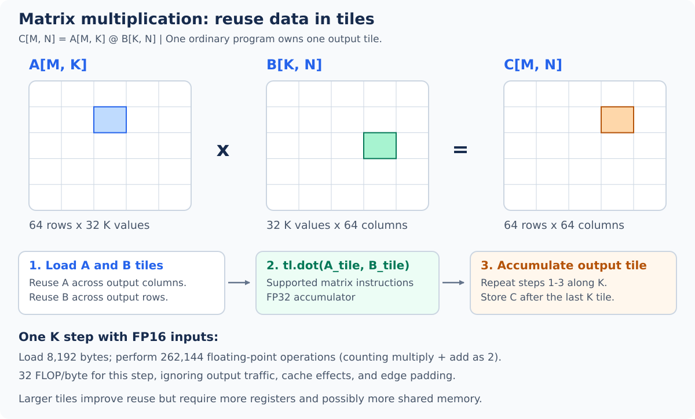

#### 12.1 The mathematical operation

For `A` of shape `[M, K]` and `B` of shape `[K, N]`, the output `C` has shape `[M, N]`:

```text
C[m, n] = sum over k of A[m, k] * B[k, n]
```

A direct implementation could reread the same inputs for many output elements. Tiling makes that reuse explicit.

#### 12.2 Assign one output tile to each program

Use three compile-time dimensions:

| Parameter | Meaning | Illustrative value |
| --- | --- | --- |
| `BM` | Rows of the output tile | 64 |
| `BN` | Columns of the output tile | 64 |
| `BK` | Elements of the reduction dimension loaded per iteration | 32 |

Each program:

1. Chooses an output tile using `pid_m` and `pid_n`.
2. Creates a `[BM, BN]` FP32 accumulator initially filled with zeros.
3. Loads an A tile of shape `[BM, BK]`.
4. Loads a B tile of shape `[BK, BN]`.
5. Adds their matrix product into the accumulator with `tl.dot`.
6. Advances to the next tile along K and repeats.
7. Stores the final `[BM, BN]` tile, masking rows or columns outside the output shape.

For `M=130`, `N=150`, and `K=70` with these sizes:

```text
grid = (ceil(130 / 64), ceil(150 / 64)) = (3, 3)
program instances = 9
K iterations per program = ceil(70 / 32) = 3
last K tile = positions 64..95; only 64..69 are valid
```

Masks pad invalid A and B inputs with zero. Each program keeps ownership of its output tile throughout the K loop, so no output atomics are needed.

#### 12.3 The tile kernel and host wrapper

Save the following complete teaching example as `tiled_matmul.py`. It supports contiguous FP16 or BF16 matrices of positive size, with matching dtype and CUDA device. It returns an FP32 output and uses FP32 accumulation. Its fixed configuration is intended to explain the algorithm, not to compete with a tuned library.

```python
import torch
import triton
import triton.language as tl


@triton.jit
def matmul_kernel(A, B, C, M, N, K,
                  stride_am, stride_ak, stride_bk, stride_bn,
                  stride_cm, stride_cn,
                  BM: tl.constexpr, BN: tl.constexpr, BK: tl.constexpr):
    rows = tl.program_id(0) * BM + tl.arange(0, BM)
    cols = tl.program_id(1) * BN + tl.arange(0, BN)
    ks = tl.arange(0, BK)
    acc = tl.zeros((BM, BN), dtype=tl.float32)

    for k_tile in range(tl.cdiv(K, BK)):
        k = k_tile * BK + ks
        a_ptrs = A + rows[:, None] * stride_am + k[None, :] * stride_ak
        b_ptrs = B + k[:, None] * stride_bk + cols[None, :] * stride_bn
        a_valid = (rows[:, None] < M) & (k[None, :] < K)
        b_valid = (k[:, None] < K) & (cols[None, :] < N)
        a = tl.load(a_ptrs, mask=a_valid, other=0.0)
        b = tl.load(b_ptrs, mask=b_valid, other=0.0)
        acc = tl.dot(a, b, acc)

    c_ptrs = C + rows[:, None] * stride_cm + cols[None, :] * stride_cn
    c_valid = (rows[:, None] < M) & (cols[None, :] < N)
    tl.store(c_ptrs, acc, mask=c_valid)


def tiled_matmul(a, b):
    if not (a.is_cuda and b.is_cuda and a.device == b.device):
        raise ValueError("Inputs must be CUDA tensors on the same device.")
    if a.ndim != 2 or b.ndim != 2 or a.shape[1] != b.shape[0]:
        raise ValueError("Expected compatible 2D matrices.")
    if a.dtype not in (torch.float16, torch.bfloat16) or b.dtype != a.dtype:
        raise ValueError("Inputs must have matching FP16 or BF16 dtype.")
    if not (a.is_contiguous() and b.is_contiguous()):
        raise ValueError("This example requires contiguous matrices.")
    m, k = a.shape
    _, n = b.shape
    if min(m, n, k) <= 0:
        raise ValueError("Matrix dimensions must be positive.")

    c = torch.empty((m, n), device=a.device, dtype=torch.float32)
    bm, bn, bk = 64, 64, 32
    grid = (triton.cdiv(m, bm), triton.cdiv(n, bn))
    with torch.cuda.device(a.device):
        matmul_kernel[grid](
            a, b, c, m, n, k,
            a.stride(0), a.stride(1), b.stride(0), b.stride(1),
            c.stride(0), c.stride(1),
            BM=bm, BN=bn, BK=bk, num_warps=4, num_stages=3,
        )
    return c


if __name__ == "__main__":
    if not torch.cuda.is_available():
        raise RuntimeError("A working CUDA GPU is required.")
    torch.manual_seed(0)
    torch.set_float32_matmul_precision("highest")  # FP32 reference without TF32.
    for m, n, k in ((64, 64, 32), (130, 150, 70)):
        a = torch.randn((m, k), device="cuda", dtype=torch.float16)
        b = torch.randn((k, n), device="cuda", dtype=torch.float16)
        expected = a.float() @ b.float()
        torch.testing.assert_close(tiled_matmul(a, b), expected,
                                   rtol=1e-3, atol=1e-3)
    print("Tiled-matmul checks passed.")
```

The check selects `"highest"` FP32 reference precision to avoid comparing against a TF32 computation. [PyTorch matrix precision API](https://docs.pytorch.org/docs/stable/generated/torch.set_float32_matmul_precision.html)

#### 12.4 Why the H100 Tensor Cores matter

- `tl.dot` describes a matrix operation, unlike elementwise `a * b`.
- With eligible shapes and types, Triton can lower that operation to Tensor Core instructions.
- Elementwise vector addition and the softmax kernel above do not become Tensor Core operations merely because they run on an H100.
- H100 supports several matrix precision paths. FP16/BF16 input with FP32 accumulation is a useful starting point.
- FP32 `tl.dot` has an `input_precision` setting; TF32 and IEEE paths have different accuracy/performance characteristics. Set and validate the precision you need.
- FP8 requires deliberate scaling, range, and accuracy handling. Choosing a smaller dtype alone is not a complete numerical strategy. [Triton dot API](https://triton-lang.org/main/python-api/generated/triton.language.dot.html)

#### 12.5 Work out the reuse

For one `64 × 64 × 32` K step with FP16 inputs:

```text
A elements loaded = 64 * 32 = 2048
B elements loaded = 32 * 64 = 2048
Input bytes = (2048 + 2048) * 2 = 8192
Floating-point operations = 2 * 64 * 64 * 32 = 262144
Input arithmetic intensity = 262144 / 8192 = 32 FLOP/byte
```

The factor two counts a multiply and an add as two operations. Each A value contributes to 64 output columns; each B value contributes to 64 output rows. This is algorithmic reuse within the tile, even though the compiler's actual storage and instructions are more complex.

This per-step estimate excludes output traffic, padding, and cache reuse between programs. It is not a measurement of the kernel's HBM traffic.

For further optimization, learn launch ordering for L2 reuse, tile-size autotuning, and pipelining from the [official Triton matrix multiplication tutorial](https://triton-lang.org/main/getting-started/tutorials/03-matrix-multiplication.html).

## Part IV: Performance, correctness, and practice

Use the hardware, CUDA, and Triton models together to explain performance, validate results, and choose the next exercises.

### 13. Memory-bound versus compute-bound kernels

The GPU must move data **and** perform arithmetic. A useful first question is which resource puts the tighter limit on an operation's throughput.

#### 13.1 What the two bounds mean

| Situation | Plain-language meaning | Typical optimization direction |
| --- | --- | --- |
| Memory bandwidth bound | The limiting memory level cannot deliver or accept useful bytes faster | Transfer fewer bytes, coalesce accesses, and reuse data |
| Compute throughput bound | The relevant arithmetic units cannot process useful operations faster | Use an eligible faster arithmetic path and keep its units supplied with work |
| Latency, dependency, or launch limited | The kernel does not sustain either resource's throughput | Expose independent work, improve scheduling, or reduce overhead |

1. **Bandwidth** is bytes transferred per second. **Latency** is how long an individual operation takes to complete; waiting on loads does not automatically mean bandwidth is saturated.
2. A bandwidth bound can occur at HBM, L2, or another memory level. Identify the level before deciding what to optimize.
3. Compute throughput depends on the actual instruction path. FP32 arithmetic, Tensor Core matrix arithmetic, and exponentials have different limits.
4. A tiny vector addition can be launch limited even though a large streaming vector addition is a bandwidth-bound candidate.
5. Classify the measured kernel for its shape, dtype, layout, and launch settings. An operation's name alone does not establish its bottleneck. [NVIDIA kernel performance triage](https://docs.nvidia.com/nsight-compute/ComputeTriage/index.html)

#### 13.2 Arithmetic intensity and the roofline idea

**Arithmetic intensity** is the amount of arithmetic performed per byte moved at the memory level being studied:

```text
intensity = floating-point operations / bytes moved
          = FLOP/byte

Performance upper bound = min(compute peak,
                              memory bandwidth * arithmetic intensity)

Units: (bytes/second) * (FLOP/byte) = FLOP/second
```

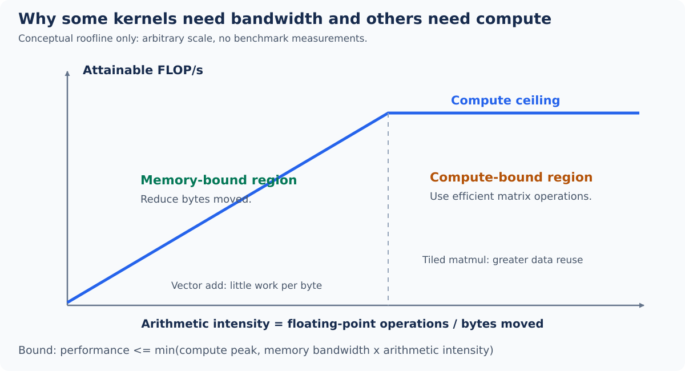

Read the conceptual graph from left to right:

1. **Horizontal axis:** arithmetic performed per byte transferred. Moving right means more reuse or more arithmetic for each byte.
2. **Vertical axis:** arithmetic throughput. Moving up means more useful FLOPs per second.
3. **Sloped roof:** with little work per byte, memory bandwidth limits the model. Doubling intensity doubles this bandwidth-based bound.
4. **Flat roof:** once enough work is performed per byte, the selected compute peak limits the model. More reuse alone cannot raise that peak.
5. **Ridge point:** the two bounds meet at `compute peak / memory bandwidth`.
6. **Real measurements:** a kernel can sit well below either roof because of insufficient parallelism, dependencies, overheads, or inefficient instructions.

Count FLOPs consistently: a multiply plus an add counts as two, including when implemented as one fused multiply-add (FMA) instruction. Specify the memory level too: logical load bytes and bytes actually fetched from HBM differ when caches serve requests. [Nsight Compute roofline model](https://docs.nvidia.com/nsight-compute/ProfilingGuide/index.html#roofline-charts)

#### 13.3 Put H100 numbers on the graph

The following model uses the full H100 SXM, decimal units (`TB = 10^12 bytes`, `TFLOP = 10^12 FLOPs`), and these rated ceilings:

| Model resource | Value used | Interpretation |
| --- | --- | --- |
| HBM bandwidth | 3.35 TB/s | Data-transfer ceiling for this HBM model |
| Ordinary FP32 arithmetic | 67 TFLOP/s | Published FP32 peak, counting FMA as two FLOPs |
| Dense FP16/BF16 Tensor Core arithmetic | About 989.5 TFLOP/s | Derived from the published sparse peak of 1,979 TFLOP/s divided by two |

NVIDIA marks the 1,979 TFLOP/s figure **with sparsity**. Structured sparsity can double the dense Tensor Core rate, so the graph derives an approximate dense ceiling rather than using the sparse rate for ordinary dense multiplication. These are peak-model inputs, not measured kernel throughput. [NVIDIA H100 specifications](https://www.nvidia.com/en-gb/data-center/h100/), [Hopper structured sparsity](https://developer.nvidia.com/blog/nvidia-hopper-architecture-in-depth/)

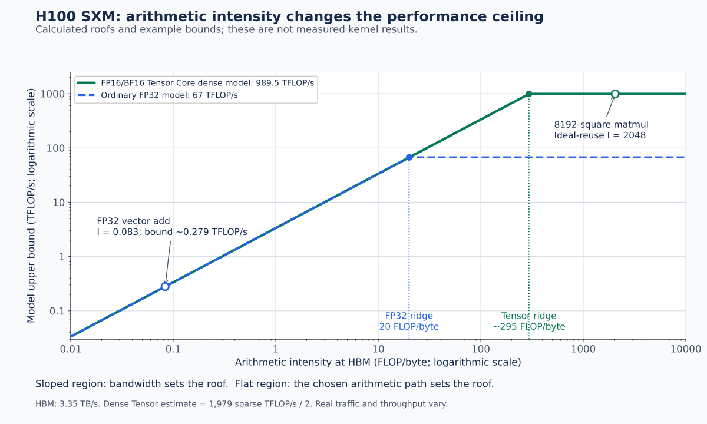

What the numerical graph teaches:

1. Both curves initially share the same HBM slope: `3.35 × intensity` gives the bandwidth bound in TFLOP/s.
2. The FP32 model reaches its roof near `67 / 3.35 = 20 FLOP/byte`.
3. The dense FP16/BF16 Tensor Core model reaches its roof near `989.5 / 3.35 ≈ 295 FLOP/byte`.
4. An intensity of 32 FLOP/byte exceeds the FP32 ridge but falls below the Tensor Core ridge. A faster arithmetic path needs more reuse to keep it fed.
5. Both axes are logarithmic: the intervals from 0.1 to 1, 1 to 10, and 10 to 100 represent equal factors of ten.
6. The hollow example markers are **calculated model bounds**, not benchmark results. The FP32 roof is also generous for addition-only code because the published peak counts FMA; the bandwidth conclusion below is unchanged.

#### 13.4 Worked memory-bound example: FP32 vector addition

For each FP32 output element, a basic streaming model counts:

```text
Read A:       4 bytes
Read B:       4 bytes
Write C:      4 bytes
Total:       12 bytes
Arithmetic:   1 addition = 1 FLOP
Intensity:    1 / 12 ≈ 0.083 FLOP/byte
```

For 100 million elements, assume the two inputs are streamed from HBM and the output is written there:

```text
FLOPs = 100,000,000 = 1e8
Bytes = 12 * 100,000,000 = 1.2e9

HBM time bound = 1.2e9 / 3.35e12 seconds ≈ 0.358 ms
Generous FP32 compute time bound = 1e8 / 67e12 seconds ≈ 0.00149 ms

Bandwidth-based performance bound
  = 3.35e12 * (1 / 12) ≈ 0.279e12 FLOP/s = 0.279 TFLOP/s
```

1. The memory estimate is much larger than the arithmetic estimate: moving the arrays dominates this model.
2. Addition-only arithmetic has a lower instruction-specific peak than the advertised FMA peak. Adjusting that compute roof still leaves a large gap to the memory estimate.
3. A well-fed large vector-add kernel can therefore be fast while using only a small fraction of the GPU's advertised FLOP/s.
4. Coalesced accesses and avoiding extra array passes matter more here than choosing a Tensor Core arithmetic path; vector addition is not a matrix product.
5. The model excludes overhead and assumes rated bandwidth. Section 15 measures the actual result and distinguishes logical bandwidth from physical HBM traffic.

#### 13.5 Worked compute-bound candidate: large dense matrix multiplication

Consider `C = A @ B`, where `A` and `B` are `8192 × 8192` FP16/BF16 matrices and `C` is an FP32 matrix. Let `L = 8192`.

For an optimistic HBM model, count each input read once and each output written once, with no initial C read:

```text
FLOPs ≈ 2 * L^3
      = 1,099,511,627,776 ≈ 1.10e12

Minimum HBM bytes = A + B + C
                  = 2*L^2 + 2*L^2 + 4*L^2
                  = 8*L^2 = 536,870,912 bytes

Ideal-reuse intensity = (2*L^3) / (8*L^2) = L/4 = 2048 FLOP/byte

HBM time bound = 536,870,912 / 3.35e12 seconds ≈ 0.160 ms
Dense Tensor compute time bound = 1.0995e12 / 989.5e12 seconds ≈ 1.111 ms
```

1. The arithmetic estimate is larger under these assumptions, putting this example on the compute side of the Tensor Core roofline.
2. Matrix multiplication can reuse each input across many multiply-adds. An optimized implementation needs effective tiling, staging, and scheduling to approach this behavior.
3. The one-read-per-input calculation is an **optimistic traffic minimum**, not a claim that the teaching kernel or a particular cache layout achieves it.
4. Section 12's `64 × 64 × 32` step has an input-tile intensity of 32 FLOP/byte. That counts tile loads; the 2,048 figure assumes whole-operation reuse at HBM. They have different traffic assumptions and must not be substituted for each other.
5. Repeated HBM fetches, small tiles, poor Tensor Core feeding, or register spills can make an actual implementation memory or latency limited. Profile before calling the measured kernel compute bound.

#### 13.6 Compare memory time with compute time

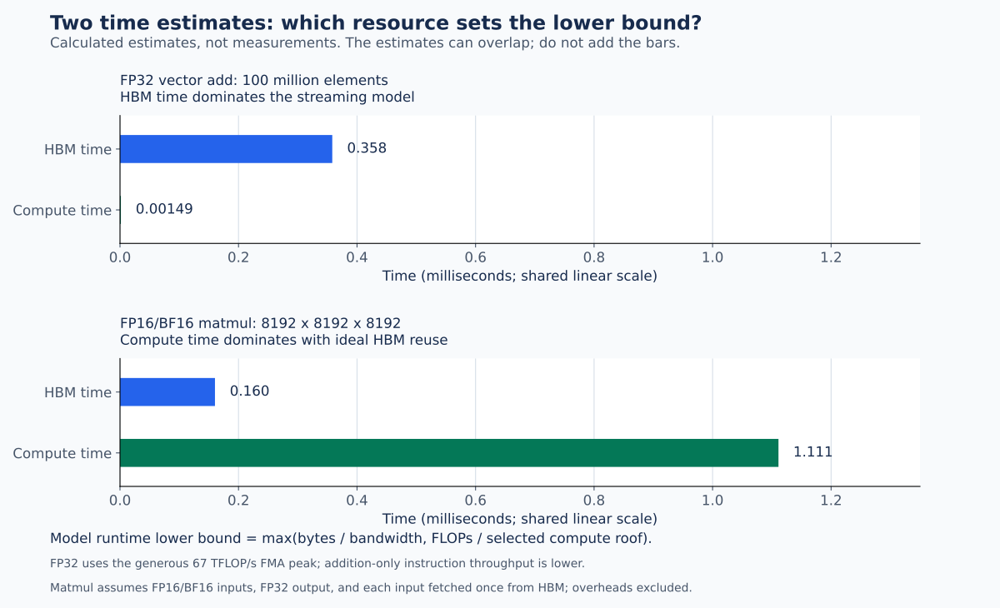

| Example and assumptions | Intensity | HBM time estimate | Compute time estimate | Larger model limit |
| --- | --- | --- | --- | --- |
| 100 million FP32 vector additions, streaming traffic | 0.083 FLOP/byte | 0.358 ms | 0.00149 ms using the generous FP32 roof | Memory |
| 8192-square FP16/BF16 matmul, FP32 output, ideal HBM reuse | 2,048 FLOP/byte | 0.160 ms | 1.111 ms using the dense Tensor Core roof | Compute |

Read the bar graph this way:

1. Both panels use the same linear time scale. The vector-add arithmetic bar is tiny because the arithmetic estimate is tiny.
2. Compare the two bars **within each workload** to find its tighter resource bound.
3. Data movement and arithmetic can overlap, so do not add the bars as a runtime prediction.
4. The model gives `runtime >= max(bytes / bandwidth, FLOPs / compute peak)`. Dependencies and incomplete overlap can make the real time longer.
5. These graphs contain no measured speedup or promised runtime. Clocks, cache state, actual traffic, and instruction choice affect measurements.

#### 13.7 Choose optimizations that address the bottleneck

| Example or observation | Why it matters | Useful Triton actions to try |
| --- | --- | --- |
| Large streaming add or copy approaches HBM bandwidth | Few operations per transferred byte | Coalesce addresses; avoid extra loads/stores; fuse nearby elementwise operations |
| Large eligible matmul sustains Tensor Core work | Reuse makes high arithmetic throughput valuable | Use `tl.dot`; tune `BM`, `BN`, `BK`, warp count, and supported pipeline settings |
| Softmax spends time moving intermediate arrays | Separate stages store and reload values | Fuse load, max, exp, sum, normalization, and store within a program |
| Softmax remains slow after fusion | Reductions, exponentials, dependencies, or register use can dominate | Profile the row shape and resource use; tune tile width and `num_warps` |
| Scattered loads have low throughput | Extra transactions or insufficient independent requests can waste the memory system | Inspect strides/coalescing and available parallel work |
| Very small workload has low memory and compute throughput | Too little work to amortize launches or occupy the GPU | Fuse work or batch independent problems where the application permits |

**Fusion example:** let FP32 `t = a + b`, followed by `y = relu(t)`. Two separate kernels move about 20 logical bytes per element: 12 for the addition, then 8 for reading and writing the ReLU result. A fused kernel moves about 12 bytes: read `a` and `b`, then write `y`. This removes an intermediate store/read and one launch. Actual HBM savings depend on caching, and larger fused kernels may use more registers.

Increasing tile size helps only when its reuse or scheduling benefit outweighs register pressure, padding, and reduced parallelism. Use the occupancy explanation in Section 14 to understand that tradeoff.

#### 13.8 Confirm the bottleneck with measurements

1. Time completed GPU work after compilation and warmup, using Section 15's method.
2. For a streaming kernel, compare effective bandwidth with the model, then inspect physical HBM and cache traffic when precision matters.
3. For matmul, compute achieved TFLOP/s and compare it with the matching dense arithmetic path, precision, and device variant.
4. Use Nsight Compute to inspect memory throughput, active arithmetic pipelines, warp stalls, and resource usage together.
5. If both throughput measures are low, investigate launch overhead, too few programs, dependencies, and instruction latency. Do not force every slow kernel into one of two labels.
6. Change one relevant setting, retain the correctness check, and remeasure the same representative inputs. [CUDA performance guide](https://docs.nvidia.com/cuda/cuda-c-best-practices-guide/index.html), [NVIDIA kernel performance triage](https://docs.nvidia.com/nsight-compute/ComputeTriage/index.html)

### 14. Occupancy and tuning on the H100

#### 14.1 What occupancy measures

**Occupancy** is the fraction of the architectural resident-warp capacity occupied by active resident warps. It is a resource/scheduling measure, not the same as achieved utilization or FLOP/s.

For the H100, the architectural limit is 64 resident warps per SM. Register usage, shared-memory usage, thread limits, and block limits can reduce how many blocks fit. [Hopper occupancy limits](https://docs.nvidia.com/cuda/hopper-tuning-guide/index.html#occupancy)

#### 14.2 A simplified register calculation

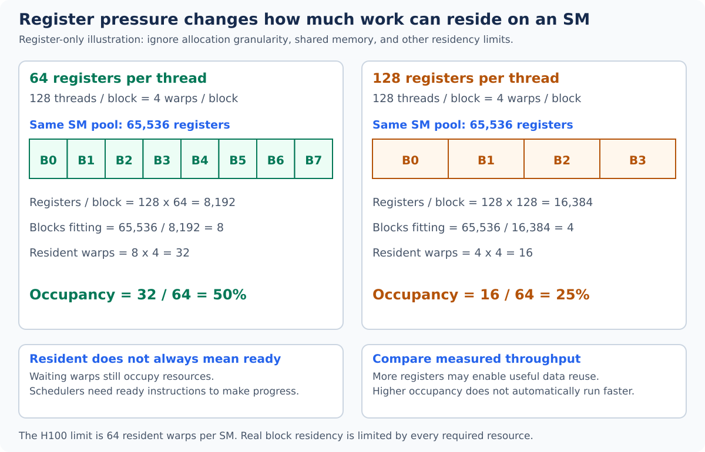

Suppose a four-warp kernel uses 64 32-bit registers per thread:

```text
Threads per block = 4 * 32 = 128
Registers per block ≈ 128 * 64 = 8192
Register-limited blocks per SM ≈ floor(65536 / 8192) = 8
Resident warps ≈ 8 * 4 = 32
Register-only occupancy estimate ≈ 32 / 64 = 50%
```

Keeping 128 threads per block but increasing to 128 registers per thread gives:

```text
Registers per block ≈ 128 * 128 = 16384
Register-limited blocks per SM ≈ floor(65536 / 16384) = 4
Resident warps ≈ 4 * 4 = 16
Register-only occupancy estimate ≈ 16 / 64 = 25%
```

This illustrative calculation ignores allocation granularity, other limits, and the compiler's actual resource report. If each block also needs 64 KB of shared memory, that resource can lower residency further. Profiling and compiler metadata give the practical answer.

More occupancy can help hide latency, but a lower-occupancy kernel may run faster if it has better reuse or instruction-level parallelism. A resident warp waiting on a dependency still occupies resources; the scheduler needs ready instructions to make progress. Do not optimize this percentage in isolation.

#### 14.3 The main tuning controls

| Control | What it changes | Possible benefit | Possible cost |
| --- | --- | --- | --- |
| Vector/reduction `BLOCK_SIZE` | Logical values per program | More work per launch group | More live values, padding, and register pressure |
| Matmul `BM` / `BN` | Output-tile shape | Greater reuse of loaded inputs | Larger accumulators and fewer output tiles |
| Matmul `BK` | K work per loop step | Different memory and matrix-instruction scheduling | Larger input tiles and staging requirements |
| `num_warps` | Threads cooperating in an ordinary program | More parallel work within a tile | More resource usage or communication |
| `num_stages` | Compiler software-pipeline depth where supported | Overlap loading later tiles with current computation | More buffering and resource use |
| Program-to-tile ordering | Which logical tiles programs own | Better opportunities for L2 reuse | More indexing complexity; physical order is still not guaranteed |
| Fusion | Operations performed before an output store | Fewer launches and intermediate transfers | Longer live ranges and more registers |

`num_stages` is not a count of SMs, warps, or Python threads. Its effect depends on the kernel's loops and compiler support. [Triton configuration API](https://triton-lang.org/main/python-api/generated/triton.Config.html)

#### 14.4 A practical tuning process

1. Start with a correct kernel and explicit shape, layout, and dtype constraints.
2. Measure representative workloads, including shapes with tails.
3. Try a small set of tile sizes and warp counts.
4. For pipelined matmul, vary stage counts while watching resource use.
5. Compare throughput and latency, not just occupancy.
6. Keep a trusted reference check when changing layouts or precision.
7. Record the GPU variant, package versions, and settings alongside the result.

For example, a vector kernel can try block sizes 128, 256, 512, and 1,024 before introducing a larger search. Triton's autotuner can select among `triton.Config` candidates; make sure the tuning key reflects important shape/dtype differences, and reset state if trial launches mutate inputs or accumulate outputs. [Triton autotune API](https://triton-lang.org/main/python-api/generated/triton.autotune.html)

#### 14.5 Hopper features to learn later

| Feature | What it adds | Where it becomes useful |
| --- | --- | --- |
| Tensor Memory Accelerator (TMA) | Asynchronous movement of eligible multidimensional tiles | Advanced global-to-shared staging pipelines |
| [Warpgroup matrix instructions](https://docs.nvidia.com/cutlass/4.5.2/media/docs/pythonDSL/mma_docs/wgmma_programming.html) | Matrix operations coordinated across four warps | Advanced Tensor Core execution paths |
| Thread block clusters | Cooperative groups of blocks with additional locality/synchronization facilities | Algorithms needing cooperation beyond one block |
| Warp specialization | Different warps handle different parts of a pipeline | Overlapping data movement and computation |

Basic `tl.load` and `tl.dot` expressions do not guarantee a particular TMA or warpgroup instruction path. Eligibility, compiler version, configuration, and the API used matter. These are later topics after ordinary tile ownership, masks, reductions, and resource limits are comfortable. [Hopper asynchronous features](https://developer.nvidia.com/blog/nvidia-hopper-architecture-in-depth/), [Triton persistent matmul tutorial](https://triton-lang.org/main/getting-started/tutorials/09-persistent-matmul.html)

### 15. How to measure performance

#### 15.1 Time completed GPU work

1. Run the kernel once to trigger compilation before steady-state timing.
2. Warm up to separate initial setup from repeated execution.
3. Use CUDA events or Triton's benchmark helper; timing only the Python enqueue call is misleading.
4. Keep allocations and host-to-device copies outside kernel-only measurements.
5. Measure the full application path separately when that is what matters.
6. Report multiple problem sizes: small sizes expose overhead; larger sizes expose sustained throughput.

#### 15.2 Benchmark the vector-add kernel

Add this block after the definitions in `vector_add.py`, or run it in an environment where `add`, `add_kernel`, and the imports above are defined:

```python
import triton.testing

n = 16 * 1024 * 1024
a = torch.randn(n, device="cuda", dtype=torch.float32)
b = torch.randn_like(a)
c = torch.empty_like(a)
grid = (triton.cdiv(n, 256),)


def launch_add():
    add_kernel[grid](a, b, c, n, BLOCK_SIZE=256, num_warps=4)


launch_add()  # Compile once before the steady-state benchmark.
torch.cuda.synchronize(a.device)
ms = triton.testing.do_bench(launch_add, return_mode="median")
logical_bytes = 3 * n * a.element_size()
effective_gbps = logical_bytes / (ms * 1e-3) / 1e9
print(f"Median time: {ms:.4f} ms; effective bandwidth: {effective_gbps:.1f} GB/s")
```

`do_bench` reports milliseconds. This example reuses a preallocated output so the measured function focuses on the launch and kernel rather than output allocation. [Benchmark helper API](https://triton-lang.org/main/python-api/generated/triton.testing.do_bench.html)

The printed bandwidth uses **logical bytes**: two reads and one write. It is not a hardware counter for HBM traffic. Cache hits can make effective bandwidth differ from physical memory bandwidth. For streaming tests, choose a working set larger than L2 and inspect memory traffic when you need a precise explanation.

#### 15.3 What to record or plot

| Measurement | Useful question |
| --- | --- |
| Latency versus input size | When does launch overhead stop dominating? |
| Effective GB/s versus input size | Does a streaming kernel approach stable throughput? |
| Matmul TFLOP/s, using `2*M*N*K / seconds / 1e12` | Is compute throughput improving for the chosen dtype? |
| Registers, shared memory, and achieved occupancy | Did a tile change reduce residency or cause spills? |
| Memory transactions and cache hit rates | Are loads coalesced and reused as expected? |

Triton's `perf_report` helper can generate plots from measured results. NVIDIA Nsight Compute can explain kernel-level bottlenecks; Nsight Systems can help examine launches, transfers, and application-level overlap. [Triton benchmark plotting](https://triton-lang.org/main/python-api/generated/triton.testing.perf_report.html), [Nsight Compute guide](https://docs.nvidia.com/nsight-compute/ProfilingGuide/index.html), [Nsight Systems guide](https://docs.nvidia.com/nsight-systems/UserGuide/index.html)

To place a **measured** kernel point on an HBM roofline, use `x = FLOPs / measured HBM bytes` and `y = FLOPs / elapsed seconds`. Keep the workload and counting conventions consistent. Using estimated logical bytes produces a different intensity estimate; label it accordingly. Repeatedly reading cache-resident inputs can move a kernel away from the streaming assumptions in Section 13.

### 16. Correctness, debugging, and common mistakes

#### 16.1 Check correctness before tuning

- Compare with a trusted reference such as PyTorch.
- Test sizes 1, one less than a tile, exactly a tile, and one more than a tile.
- Test dimensions that are not multiples of any tile size.
- Handle empty tensors deliberately rather than accidentally launching an empty grid.
- Validate supported dtype, device, shape, and layout at the wrapper boundary.
- Use tolerances appropriate for the arithmetic and output type. Reduction order and reduced precision can change floating-point results.
- Check who owns each output address. For the examples, every valid output has exactly one writer.
- Treat these wrappers as forward examples; adding them to a training system requires backward/autograd integration.

#### 16.2 Useful debugging tools

| Tool | When to use it |
| --- | --- |
| `tl.static_assert` / `tl.static_print` | Check or inspect compile-time properties |
| `tl.device_print` | Inspect a small number of runtime values |
| `tl.device_assert` with `TRITON_DEBUG=1` | Enable runtime checks during development |
| `TRITON_INTERPRET=1` | Simulate supported Triton operations for inspecting logic; not a GPU performance measurement |
| NVIDIA Compute Sanitizer | Investigate invalid memory access, races, and synchronization issues |
| `CUDA_LAUNCH_BLOCKING=1` | Localize asynchronous errors while debugging; disable for performance measurements |

The interpreter has limitations and does not validate hardware scheduling or performance. See the [Triton debugging guide](https://triton-lang.org/main/programming-guide/chapter-3/debugging.html) and [CUDA debugging environment variables](https://docs.nvidia.com/cuda/cuda-programming-guide/05-appendices/environment-variables.html).

If you saved the vector example locally, useful GPU-side commands include:

```bash
TRITON_DEBUG=1 python vector_add.py
compute-sanitizer --tool memcheck python vector_add.py
```

#### 16.3 Common misunderstandings

| Mistake | What to do instead |
| --- | --- |
| Treating `BLOCK_SIZE` as the number of threads | Separate logical tile size from `num_warps × 32` for ordinary NVIDIA launches |
| Treating `tl.arange` as `threadIdx.x` | Think of logical element positions distributed by the compiler |
| Assuming program ID selects an SM | Use it to select data; let hardware place the block |
| Assuming programs run in ID order | Keep programs independent or design an explicit coordination method |
| Guarding unsafe loads only with `tl.where` | Put masks on the loads themselves |
| Masking stores but leaving tail loads unmasked | Mask both reads and writes |
| Using zero padding for every reduction | Choose the operation's neutral value |
| Treating strides as bytes | Use element strides with typed pointers |
| Assuming every `tl.load` goes through shared memory | Distinguish logical values, caches, registers, and cooperative staging |
| Using an enormous tile to “use the whole H100” | Balance reuse, parallel program count, and resource consumption |
| Maximizing occupancy as the only goal | Measure latency/throughput and inspect bottlenecks |
| Expecting Tensor Cores to speed up any expression | Use eligible matrix operations and appropriate types |
| Timing the first call or only host enqueue time | Separate compilation and use completed GPU-work timing |
| Using published full-GPU specs for a MIG partition | Inspect the resources actually exposed to the process |

### 17. Practice path and quick reference

#### 17.1 Build understanding one step at a time

| Step | Exercise | Concept to explain before moving on |
| --- | --- | --- |
| 1 | Run vector addition at tail sizes | Program ID, offsets, masks, and one writer per output |
| 2 | Change it to `y = scale * x + bias` | Scalar broadcasting and elementwise fusion |
| 3 | Add ReLU without an intermediate tensor | Fewer global transfers and launches |
| 4 | Write one sum per input row | Reductions and neutral padding |
| 5 | Run and inspect row softmax | Stable exponentiation and multiple local reductions |
| 6 | Address a small 2D tile using explicit strides | Broadcasting and multidimensional pointer arithmetic |
| 7 | Run tiled matmul on odd dimensions | Output ownership, a K loop, zero padding, and `tl.dot` |
| 8 | Compare several tile/warp settings | Resource tradeoffs and workload-dependent tuning |
| 9 | Record real timings and draw throughput plots | Measurement, effective bandwidth, and arithmetic intensity |

#### 17.2 Questions to ask about every kernel

1. Which output addresses does each program own?
2. Which logical tile shapes exist inside the program?
3. How many programs cover the whole problem?
4. Which pointers can cross a boundary, and are those operations masked?
5. Are addresses friendly to coalescing and reuse?
6. How much work is performed per byte transferred?
7. Are registers or shared memory limiting the configuration?
8. Does the reference comparison cover tails, precision, and supported layouts?
9. Was performance measured after compilation and with completed GPU work?

#### 17.3 Compact mental model

```text
Python host code
  -> allocates device tensors and selects a grid
  -> launches many Triton program instances
       -> each chooses a logical tile
       -> compiler distributes tile work across warps and threads
       -> hardware schedules ordinary blocks onto SMs
       -> loads, arithmetic/reductions/dot, and masked stores execute
  -> later host or GPU operations consume the result
```

Write down tile ownership first. Then make memory access safe and efficient. Tune only after the result is correct and the measurements answer a concrete question.

### 18. Official documentation and further reading

#### Hardware and execution

- [NVIDIA Hopper architecture overview](https://developer.nvidia.com/blog/nvidia-hopper-architecture-in-depth/): H100 organization, SM resources, Tensor Cores, and asynchronous features. Its early performance table is preliminary; the rated memory-bandwidth figure used here comes from the newer HGX specifications.
- [NVIDIA HGX hardware specifications](https://docs.nvidia.com/enterprise-reference-architectures/hgx-ai-factory-h100-h200-b200/latest/components.html): H100 SXM HBM3 capacity and bandwidth.
- [NVIDIA H100 product specifications](https://www.nvidia.com/en-gb/data-center/h100/): published arithmetic peaks and the sparsity footnote used in the performance models.
- [Hopper tuning guide](https://docs.nvidia.com/cuda/hopper-tuning-guide/index.html): resident-warps, register, shared-memory, and other architectural limits.
- [CUDA programming model](https://docs.nvidia.com/cuda/cuda-programming-guide/01-introduction/programming-model.html): host/device execution, blocks, warps, and memory.
- [CUDA best practices](https://docs.nvidia.com/cuda/cuda-c-best-practices-guide/index.html): coalescing, bandwidth, resource tradeoffs, and measurement.
- [Nsight Compute roofline guide](https://docs.nvidia.com/nsight-compute/ProfilingGuide/index.html#roofline-charts) and [kernel performance triage](https://docs.nvidia.com/nsight-compute/ComputeTriage/index.html): interpreting ceilings, measured throughput, and bottlenecks.

#### Triton learning sequence

- [Installation](https://triton-lang.org/main/getting-started/installation.html) and [language API](https://triton-lang.org/main/python-api/triton.language.html).
- [Vector addition](https://triton-lang.org/main/getting-started/tutorials/01-vector-add.html).
- [Fused softmax](https://triton-lang.org/main/getting-started/tutorials/02-fused-softmax.html).
- [Matrix multiplication](https://triton-lang.org/main/getting-started/tutorials/03-matrix-multiplication.html).
- [Layer normalization](https://triton-lang.org/main/getting-started/tutorials/05-layer-norm.html).
- [Fused attention](https://triton-lang.org/main/getting-started/tutorials/06-fused-attention.html).
- [Persistent matmul](https://triton-lang.org/main/getting-started/tutorials/09-persistent-matmul.html): check the architecture requirements for each advanced variant.
- [Debugging](https://triton-lang.org/main/programming-guide/chapter-3/debugging.html).

The examples here use the standard `triton.language` API. The linked `main` documentation follows Triton's development branch, so advanced APIs can differ from the version installed in your environment. Record versions when sharing examples and benchmark results.

#### Regenerate the calculated graphs

The two numerical performance graphs are generated with Matplotlib by [docs/generate_performance_graphs.py](docs/generate_performance_graphs.py). With Matplotlib installed, run this command from the repository root; no GPU is required:

```bash
python docs/generate_performance_graphs.py
```

The script writes standalone SVGs into `docs/images`. It calculates roofline and time bounds from the stated model inputs; it does not run GPU benchmarks.
