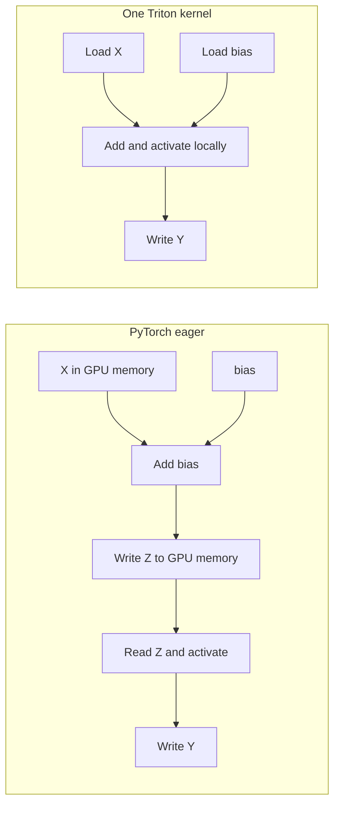

# 3. Fused bias + activation: two operations in one kernel

Previous: [ReLU / SiLU / GELU](02_relu_silu_gelu.md). Next: [sum reduction](04_sum_reduction.md).

This is a self-contained Markdown notebook. Run the examples in sections 1–8 in order in a fresh notebook, or run the final complete code block on its own. The final block can also be saved as a Python script. The examples support a contiguous, finite **FP32 matrix and FP32 bias vector on one NVIDIA CUDA GPU**. They implement forward computation; a PyTorch backward operation is not registered for the custom kernels.

## The operation and its equation

A neural-network layer often adds a bias and then applies an activation. Here, the bias has one value for each column and is reused across every row.

For $X\in\mathbb{R}^{M\times N}$, $b\in\mathbb{R}^{N}$, and activation $f$:

$$
Z_{r,c}=X_{r,c}+b_c,\qquad
Y_{r,c}=f(Z_{r,c})=f(X_{r,c}+b_c).
$$

The activation can be any of the following:

$$
\begin{aligned}
\operatorname{ReLU}(z)&=\max(0,z),\\
\operatorname{SiLU}(z)&=\frac{z}{1+e^{-z}},\\
\operatorname{GELU}(z)&=\frac{z}{2}\left(1+\operatorname{erf}(z/\sqrt{2})\right).
\end{aligned}
$$

We also include the tanh GELU approximation from the [activation guide](02_relu_silu_gelu.md). Its PyTorch reference must use `approximate="tanh"`; the erf formula uses `approximate="none"`. See the [PyTorch GELU definition](https://docs.pytorch.org/docs/stable/generated/torch.nn.functional.gelu.html).

### A worked example with ReLU

```text
X = [ [-2, -1,  0,  1],       bias = [0.5, 1, -1, 2]
      [ 2, -3,  4, -5] ]                 │
                                        │ broadcast across rows
Z = [ [-1.5,  0, -1,  3],     <──────────┘
      [ 2.5, -2,  3, -3] ]

Y = ReLU(Z)
  = [ [ 0.0,  0,  0,  3],
      [ 2.5,  0,  3,  0] ]
```

Broadcasting does not require creating an $M\times N$ copy of the bias. The kernel selects the appropriate bias element using each output element's column index.

## Why fuse the operations?

In ordinary eager PyTorch, adding bias creates an intermediate tensor `Z`; the activation then reads it. The fused kernel computes both operations before writing an output.



Ignoring bias reads and cache effects, the eager path moves four matrix-sized quantities: read `X`, write `Z`, read `Z`, write `Y`. The fused path moves two: read `X`, write `Y`. For FP32, those estimates are $16MN$ and $8MN$ bytes, respectively. Fusion also combines two device launches into one. These are logical traffic estimates, not measured HBM transactions; neither guarantees a particular speedup.

The intermediate still exists as local values inside the fused computation. It no longer needs its own full-sized global-memory tensor. The [official fused-softmax tutorial](https://triton-lang.org/main/getting-started/tutorials/02-fused-softmax.html) demonstrates the same broader reason to fuse operations.

## 1. Imports and example inputs

Install a CUDA-enabled PyTorch build and Triton if needed; see the [PyTorch installer](https://pytorch.org/get-started/locally/) and [Triton installation guide](https://triton-lang.org/main/getting-started/installation.html).

```python
import torch
import torch.nn.functional as F
import triton
import triton.language as tl
import triton.testing
from triton.language.extra import libdevice

if not torch.cuda.is_available() or torch.version.hip is not None:
    raise RuntimeError("This notebook requires a working NVIDIA CUDA GPU.")

DEVICE = torch.device("cuda", torch.cuda.current_device())
DTYPE = torch.float32
KINDS = ("relu", "silu", "gelu", "gelu_tanh")
torch.manual_seed(0)
torch.set_printoptions(precision=6, sci_mode=False)

x = torch.tensor(
    [[-2.0, -1.0, 0.0, 1.0], [2.0, -3.0, 4.0, -5.0]],
    device=DEVICE,
    dtype=DTYPE,
)
bias = torch.tensor([0.5, 1.0, -1.0, 2.0], device=DEVICE, dtype=DTYPE)
print("PyTorch:", torch.__version__, "Triton:", triton.__version__)
print("GPU:", torch.cuda.get_device_name(DEVICE))
```

## 2. PyTorch eager: add bias, then activate

```python
z = x + bias                 # Shapes: (2, 4) + (4,) -> (2, 4)
y_eager = F.relu(z)

eager_outputs = {
    "relu": y_eager,
    "silu": F.silu(z),
    "gelu": F.gelu(z, approximate="none"),
    "gelu_tanh": F.gelu(z, approximate="tanh"),
}
print("X:\n", x.cpu())
print("Bias:\n", bias.cpu())
print("X + bias:\n", z.cpu())
print("ReLU(X + bias):\n", y_eager.cpu())
```

1. `x + bias` broadcasts the bias across rows and creates the intermediate `z`.
2. `F.relu(z)` creates the output by replacing negative elements of `z` with zero.
3. Other activation choices use the same biased values with different nonlinear math.

The expected ReLU result is `[[0.0, 0.0, 0.0, 3.0], [2.5, 0.0, 3.0, 0.0]]`.

## 3. PyTorch function: reusable bias + activation

```python
def bias_activation_torch(x, bias, kind="relu"):
    z = x + bias
    if kind == "relu":
        return F.relu(z)
    if kind == "silu":
        return F.silu(z)
    if kind == "gelu":
        return F.gelu(z, approximate="none")
    if kind == "gelu_tanh":
        return F.gelu(z, approximate="tanh")
    raise ValueError(f"Unknown activation: {kind}")


for kind in KINDS:
    result = bias_activation_torch(x, bias, kind)
    torch.testing.assert_close(result, eager_outputs[kind], rtol=0, atol=0)
```

Wrapping eager operations in a Python function does not fuse them. The function still forms `z` before applying the activation. The performance comparison below uses this eager baseline.

## Flattened offsets and bias broadcasting

A contiguous matrix can be addressed as one flat array. For flat offset $i$:

$$
r=\lfloor i/N\rfloor,\qquad c=i\bmod N.
$$

The matrix element is at `X + i`, and its bias is at `Bias + (i % N)`.

```text
M = 2, N = 4

flat offset:  0  1  2  3 | 4  5  6  7
column:       0  1  2  3 | 0  1  2  3
bias read:   b0 b1 b2 b3 | b0 b1 b2 b3
```

Tiles can cross row boundaries; modulo indexing still picks the right column. This approach does not need a tile large enough to hold an entire row. It requires a contiguous matrix, because a strided view has a different address formula.

## 4. Triton: bias and activation within one kernel

```python
@triton.jit
def apply_activation(value, KIND: tl.constexpr):
    if KIND == "relu":
        result = tl.maximum(value, 0.0)
    elif KIND == "silu":
        result = value / (1.0 + tl.exp(-value))
    elif KIND == "gelu":
        result = 0.5 * value * (1.0 + tl.erf(value * 0.7071067811865476))
    else:  # The Python wrapper permits only "gelu_tanh" here.
        inner = 0.7978845608028654 * (
            value + 0.044715 * value * value * value
        )
        result = 0.5 * value * (1.0 + libdevice.tanh(inner))
    return result


@triton.jit
def bias_activation_kernel(
    X, Bias, Y, TOTAL,
    N_COLS: tl.constexpr,
    KIND: tl.constexpr,
    BLOCK_SIZE: tl.constexpr,
):
    # 1. Assign a flat output tile to this program.
    offsets = tl.program_id(0) * BLOCK_SIZE + tl.arange(0, BLOCK_SIZE)
    valid = offsets < TOTAL

    # 2. Map each matrix element to its column's bias.
    columns = offsets % N_COLS
    values = tl.load(X + offsets, mask=valid, other=0.0).to(tl.float32)
    biases = tl.load(Bias + columns, mask=valid, other=0.0).to(tl.float32)

    # 3. Keep the intermediate local; do not store a full Z tensor.
    biased = values + biases
    activated = apply_activation(biased, KIND)

    # 4. Store the final output only.
    tl.store(Y + offsets, activated, mask=valid)
```

`N_COLS` is known at compilation time and controls the modulo indexing. `TOTAL=M*N` controls the tail mask. `KIND` selects a specialization for the activation. The JIT helper is part of the same GPU kernel; it does not launch another kernel.

For each valid output element, the kernel loads the input and its bias, adds them, applies the nonlinear function, and writes the result. There is no global `Z` allocation.

## 5. Python launch wrapper

```python
def bias_activation_triton(x, bias, kind="relu", block_size=256):
    if not (x.is_cuda and bias.is_cuda and x.device == bias.device):
        raise ValueError("Inputs must be CUDA tensors on the same device.")
    if x.ndim != 2 or bias.ndim != 1:
        raise ValueError("Expected a matrix and a one-dimensional bias.")
    if x.shape[1] == 0 or bias.numel() != x.shape[1]:
        raise ValueError("Bias length must equal the positive column count.")
    if x.dtype != torch.float32 or bias.dtype != torch.float32:
        raise ValueError("This tutorial supports FP32 inputs.")
    if not (x.is_contiguous() and bias.is_contiguous()):
        raise ValueError("Inputs must be contiguous.")
    if kind not in KINDS:
        raise ValueError(f"Unknown activation: {kind}")
    if block_size not in (128, 256, 512, 1024):
        raise ValueError("Use a block size of 128, 256, 512, or 1024.")

    y = torch.empty_like(x)
    total = x.numel()
    if total == 0:  # Zero rows are supported; zero columns are rejected above.
        return y
    with torch.cuda.device(x.device):
        bias_activation_kernel[(triton.cdiv(total, block_size),)](
            x, bias, y, total,
            N_COLS=x.shape[1], KIND=kind,
            BLOCK_SIZE=block_size, num_warps=4,
        )
    return y
```

The positive column-count check prevents modulo by zero. The zero-row case returns an empty matrix. More general bias shapes, arbitrary tensor strides, and other dtypes require extending the address calculation and validating the new semantics.

## 6. Match values and verify broadcasting and masks

```python
for kind in KINDS:
    expected = bias_activation_torch(x, bias, kind)
    actual = bias_activation_triton(x, bias, kind)
    torch.testing.assert_close(actual, expected, rtol=1e-5, atol=1e-6)
    print(f"\n{kind}: row, column | PyTorch | Triton | abs error")
    reference_rows = expected.cpu().tolist()
    result_rows = actual.cpu().tolist()
    for r in range(x.shape[0]):
        for c in range(x.shape[1]):
            ref = reference_rows[r][c]
            got = result_rows[r][c]
            print(f"({r}, {c}) | {ref:10.6f} | {got:10.6f} | {abs(ref-got):.3e}")

# Include short rows, row-crossing tiles, and a partial final tile.
for rows, columns in ((0, 7), (1, 1), (3, 7), (2, 255), (4, 257), (5, 1025)):
    values = torch.randn(rows, columns, device=DEVICE, dtype=DTYPE)
    biases = torch.randn(columns, device=DEVICE, dtype=DTYPE)
    for kind in KINDS:
        torch.testing.assert_close(
            bias_activation_triton(values, biases, kind),
            bias_activation_torch(values, biases, kind),
            rtol=1e-5,
            atol=1e-6,
        )

print("All activation, broadcasting, and boundary checks passed.")
```

Inspecting both rows catches a wrong bias mapping that a single-row example might miss. The non-power-of-two column counts exercise row crossing and tail masking. Floating-point tolerances allow small differences in activation math while checking the same formula.

## 7. Compare eager, function, and fused-kernel times

```python
def bench_ms(fn):
    for _ in range(5):
        fn()
    torch.cuda.synchronize(DEVICE)
    return triton.testing.do_bench(
        fn, warmup=25, rep=100, return_mode="median"
    )


eager_ops = {
    "relu": lambda values, biases: F.relu(values + biases),
    "silu": lambda values, biases: F.silu(values + biases),
    "gelu": lambda values, biases: F.gelu(values + biases, approximate="none"),
    "gelu_tanh": lambda values, biases: F.gelu(values + biases, approximate="tanh"),
}

print("kind       shape          eager us  function us  Triton us  speedup  max error")
for rows, columns in ((32, 32), (256, 256), (1024, 1024), (4096, 1024)):
    values = torch.randn(rows, columns, device=DEVICE, dtype=DTYPE)
    biases = torch.randn(columns, device=DEVICE, dtype=DTYPE)
    for kind in KINDS:
        expected = bias_activation_torch(values, biases, kind)
        actual = bias_activation_triton(values, biases, kind)
        torch.testing.assert_close(actual, expected, rtol=1e-5, atol=1e-6)
        error = (actual - expected).abs().max().item()

        eager_ms = bench_ms(lambda: eager_ops[kind](values, biases))
        function_ms = bench_ms(lambda: bias_activation_torch(values, biases, kind))
        triton_ms = bench_ms(lambda: bias_activation_triton(values, biases, kind))
        shape = f"{rows}x{columns}"
        print(
            f"{kind:10s} {shape:13s} {eager_ms*1000:9.3f} "
            f"{function_ms*1000:12.3f} {triton_ms*1000:10.3f} "
            f"{function_ms/triton_ms:7.2f}x {error:10.3e}"
        )
```

This measures the steady-state GPU latency of the allocating API calls: eager PyTorch forms an intermediate and an output; Triton forms only an output. The avoided intermediate is part of the benefit being measured. Each specialization is compiled before timing, and input creation, correctness checks, CPU copies, and printing are outside timing.

[`do_bench`](https://triton-lang.org/main/python-api/generated/triton.testing.do_bench.html) returns milliseconds; the table shows median microseconds. GPU event measurements can include host dispatch gaps but do not report the full CPU wall-clock cost. A speedup above `1.0x` indicates the fused implementation was faster in that measurement. Run the cell to obtain actual values for your GPU.

## 8. Compare preallocated two-kernel and one-kernel ReLU

Now allocate both outputs and PyTorch's intermediate before timing. This helps show the effect of avoiding the intermediate memory traffic and the second launch even when allocation is removed.

```python
rows, columns = 4096, 1024
values = torch.randn(rows, columns, device=DEVICE, dtype=DTYPE)
biases = torch.randn(columns, device=DEVICE, dtype=DTYPE)
temporary = torch.empty_like(values)
torch_out = torch.empty_like(values)
triton_out = torch.empty_like(values)
block_size = 256
total = values.numel()
grid = (triton.cdiv(total, block_size),)


def launch_torch_bias_relu():
    torch.add(values, biases, out=temporary)
    torch.clamp_min(temporary, 0.0, out=torch_out)


def launch_triton_bias_relu():
    bias_activation_kernel[grid](
        values, biases, triton_out, total,
        N_COLS=columns, KIND="relu", BLOCK_SIZE=block_size, num_warps=4,
    )


launch_torch_bias_relu()
launch_triton_bias_relu()
torch.testing.assert_close(triton_out, torch_out, rtol=0, atol=0)

torch_ms = bench_ms(launch_torch_bias_relu)
triton_ms = bench_ms(launch_triton_bias_relu)
print(f"Preallocated PyTorch bias + ReLU: {torch_ms*1000:.3f} us")
print(f"Preallocated fused Triton:      {triton_ms*1000:.3f} us")
print(f"Speedup: {torch_ms/triton_ms:.2f}x")
```

`torch.clamp_min(..., 0)` implements the same finite-input ReLU here and supports a preallocated output. Input tensors have no gradients enabled. Keep this comparison distinct from section 7 because it times a different API path.

## Try next

Try a column count such as `1003`, rerun correctness, and inspect how modulo indexing handles it. An optional later experiment is to compare against `torch.compile`, which may also fuse the PyTorch expression. Continue with [sum reduction](04_sum_reduction.md), where many input values contribute to one output rather than independent outputs.

## 9. Complete code in one block

Run this block independently in a fresh notebook cell, or save it as a Python script. It combines all the code from sections 1–8: imports, PyTorch references, Triton kernels and launch helpers, value checks, and timing comparisons. Comments mark each step.

```python
# 1. Imports and example inputs
import torch
import torch.nn.functional as F
import triton
import triton.language as tl
import triton.testing
from triton.language.extra import libdevice

if not torch.cuda.is_available() or torch.version.hip is not None:
    raise RuntimeError("This notebook requires a working NVIDIA CUDA GPU.")

DEVICE = torch.device("cuda", torch.cuda.current_device())
DTYPE = torch.float32
KINDS = ("relu", "silu", "gelu", "gelu_tanh")
torch.manual_seed(0)
torch.set_printoptions(precision=6, sci_mode=False)

x = torch.tensor(
    [[-2.0, -1.0, 0.0, 1.0], [2.0, -3.0, 4.0, -5.0]],
    device=DEVICE,
    dtype=DTYPE,
)
bias = torch.tensor([0.5, 1.0, -1.0, 2.0], device=DEVICE, dtype=DTYPE)
print("PyTorch:", torch.__version__, "Triton:", triton.__version__)
print("GPU:", torch.cuda.get_device_name(DEVICE))


# 2. PyTorch eager: add bias, then activate
z = x + bias                 # Shapes: (2, 4) + (4,) -> (2, 4)
y_eager = F.relu(z)

eager_outputs = {
    "relu": y_eager,
    "silu": F.silu(z),
    "gelu": F.gelu(z, approximate="none"),
    "gelu_tanh": F.gelu(z, approximate="tanh"),
}
print("X:\n", x.cpu())
print("Bias:\n", bias.cpu())
print("X + bias:\n", z.cpu())
print("ReLU(X + bias):\n", y_eager.cpu())


# 3. PyTorch function: reusable bias + activation
def bias_activation_torch(x, bias, kind="relu"):
    z = x + bias
    if kind == "relu":
        return F.relu(z)
    if kind == "silu":
        return F.silu(z)
    if kind == "gelu":
        return F.gelu(z, approximate="none")
    if kind == "gelu_tanh":
        return F.gelu(z, approximate="tanh")
    raise ValueError(f"Unknown activation: {kind}")


for kind in KINDS:
    result = bias_activation_torch(x, bias, kind)
    torch.testing.assert_close(result, eager_outputs[kind], rtol=0, atol=0)


# 4. Triton: bias and activation within one kernel
@triton.jit
def apply_activation(value, KIND: tl.constexpr):
    if KIND == "relu":
        result = tl.maximum(value, 0.0)
    elif KIND == "silu":
        result = value / (1.0 + tl.exp(-value))
    elif KIND == "gelu":
        result = 0.5 * value * (1.0 + tl.erf(value * 0.7071067811865476))
    else:  # The Python wrapper permits only "gelu_tanh" here.
        inner = 0.7978845608028654 * (
            value + 0.044715 * value * value * value
        )
        result = 0.5 * value * (1.0 + libdevice.tanh(inner))
    return result


@triton.jit
def bias_activation_kernel(
    X, Bias, Y, TOTAL,
    N_COLS: tl.constexpr,
    KIND: tl.constexpr,
    BLOCK_SIZE: tl.constexpr,
):
    # 1. Assign a flat output tile to this program.
    offsets = tl.program_id(0) * BLOCK_SIZE + tl.arange(0, BLOCK_SIZE)
    valid = offsets < TOTAL

    # 2. Map each matrix element to its column's bias.
    columns = offsets % N_COLS
    values = tl.load(X + offsets, mask=valid, other=0.0).to(tl.float32)
    biases = tl.load(Bias + columns, mask=valid, other=0.0).to(tl.float32)

    # 3. Keep the intermediate local; do not store a full Z tensor.
    biased = values + biases
    activated = apply_activation(biased, KIND)

    # 4. Store the final output only.
    tl.store(Y + offsets, activated, mask=valid)


# 5. Python launch wrapper
def bias_activation_triton(x, bias, kind="relu", block_size=256):
    if not (x.is_cuda and bias.is_cuda and x.device == bias.device):
        raise ValueError("Inputs must be CUDA tensors on the same device.")
    if x.ndim != 2 or bias.ndim != 1:
        raise ValueError("Expected a matrix and a one-dimensional bias.")
    if x.shape[1] == 0 or bias.numel() != x.shape[1]:
        raise ValueError("Bias length must equal the positive column count.")
    if x.dtype != torch.float32 or bias.dtype != torch.float32:
        raise ValueError("This tutorial supports FP32 inputs.")
    if not (x.is_contiguous() and bias.is_contiguous()):
        raise ValueError("Inputs must be contiguous.")
    if kind not in KINDS:
        raise ValueError(f"Unknown activation: {kind}")
    if block_size not in (128, 256, 512, 1024):
        raise ValueError("Use a block size of 128, 256, 512, or 1024.")

    y = torch.empty_like(x)
    total = x.numel()
    if total == 0:  # Zero rows are supported; zero columns are rejected above.
        return y
    with torch.cuda.device(x.device):
        bias_activation_kernel[(triton.cdiv(total, block_size),)](
            x, bias, y, total,
            N_COLS=x.shape[1], KIND=kind,
            BLOCK_SIZE=block_size, num_warps=4,
        )
    return y


# 6. Match values and verify broadcasting and masks
for kind in KINDS:
    expected = bias_activation_torch(x, bias, kind)
    actual = bias_activation_triton(x, bias, kind)
    torch.testing.assert_close(actual, expected, rtol=1e-5, atol=1e-6)
    print(f"\n{kind}: row, column | PyTorch | Triton | abs error")
    reference_rows = expected.cpu().tolist()
    result_rows = actual.cpu().tolist()
    for r in range(x.shape[0]):
        for c in range(x.shape[1]):
            ref = reference_rows[r][c]
            got = result_rows[r][c]
            print(f"({r}, {c}) | {ref:10.6f} | {got:10.6f} | {abs(ref-got):.3e}")

# Include short rows, row-crossing tiles, and a partial final tile.
for rows, columns in ((0, 7), (1, 1), (3, 7), (2, 255), (4, 257), (5, 1025)):
    values = torch.randn(rows, columns, device=DEVICE, dtype=DTYPE)
    biases = torch.randn(columns, device=DEVICE, dtype=DTYPE)
    for kind in KINDS:
        torch.testing.assert_close(
            bias_activation_triton(values, biases, kind),
            bias_activation_torch(values, biases, kind),
            rtol=1e-5,
            atol=1e-6,
        )

print("All activation, broadcasting, and boundary checks passed.")


# 7. Compare eager, function, and fused-kernel times
def bench_ms(fn):
    for _ in range(5):
        fn()
    torch.cuda.synchronize(DEVICE)
    return triton.testing.do_bench(
        fn, warmup=25, rep=100, return_mode="median"
    )


eager_ops = {
    "relu": lambda values, biases: F.relu(values + biases),
    "silu": lambda values, biases: F.silu(values + biases),
    "gelu": lambda values, biases: F.gelu(values + biases, approximate="none"),
    "gelu_tanh": lambda values, biases: F.gelu(values + biases, approximate="tanh"),
}

print("kind       shape          eager us  function us  Triton us  speedup  max error")
for rows, columns in ((32, 32), (256, 256), (1024, 1024), (4096, 1024)):
    values = torch.randn(rows, columns, device=DEVICE, dtype=DTYPE)
    biases = torch.randn(columns, device=DEVICE, dtype=DTYPE)
    for kind in KINDS:
        expected = bias_activation_torch(values, biases, kind)
        actual = bias_activation_triton(values, biases, kind)
        torch.testing.assert_close(actual, expected, rtol=1e-5, atol=1e-6)
        error = (actual - expected).abs().max().item()

        eager_ms = bench_ms(lambda: eager_ops[kind](values, biases))
        function_ms = bench_ms(lambda: bias_activation_torch(values, biases, kind))
        triton_ms = bench_ms(lambda: bias_activation_triton(values, biases, kind))
        shape = f"{rows}x{columns}"
        print(
            f"{kind:10s} {shape:13s} {eager_ms*1000:9.3f} "
            f"{function_ms*1000:12.3f} {triton_ms*1000:10.3f} "
            f"{function_ms/triton_ms:7.2f}x {error:10.3e}"
        )


# 8. Compare preallocated two-kernel and one-kernel ReLU
rows, columns = 4096, 1024
values = torch.randn(rows, columns, device=DEVICE, dtype=DTYPE)
biases = torch.randn(columns, device=DEVICE, dtype=DTYPE)
temporary = torch.empty_like(values)
torch_out = torch.empty_like(values)
triton_out = torch.empty_like(values)
block_size = 256
total = values.numel()
grid = (triton.cdiv(total, block_size),)


def launch_torch_bias_relu():
    torch.add(values, biases, out=temporary)
    torch.clamp_min(temporary, 0.0, out=torch_out)


def launch_triton_bias_relu():
    bias_activation_kernel[grid](
        values, biases, triton_out, total,
        N_COLS=columns, KIND="relu", BLOCK_SIZE=block_size, num_warps=4,
    )


launch_torch_bias_relu()
launch_triton_bias_relu()
torch.testing.assert_close(triton_out, torch_out, rtol=0, atol=0)

torch_ms = bench_ms(launch_torch_bias_relu)
triton_ms = bench_ms(launch_triton_bias_relu)
print(f"Preallocated PyTorch bias + ReLU: {torch_ms*1000:.3f} us")
print(f"Preallocated fused Triton:      {triton_ms*1000:.3f} us")
print(f"Speedup: {torch_ms/triton_ms:.2f}x")
```
