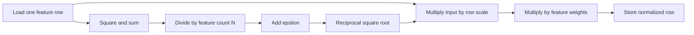

# 7. RMSNorm: rescale features using their root mean square

Previous: [softmax](06_softmax.md). Next: [LayerNorm](08_layernorm.md).

This is a self-contained Markdown notebook. Run sections 1–8 in order, or run the final complete code block independently. The examples normalize the last dimension of a contiguous **FP32 matrix on one NVIDIA CUDA GPU**, with 1–4096 features per row and a contiguous FP32 weight vector. Inputs and weights are finite, and squared reductions must remain representable in FP32. The kernels implement forward computation without a registered PyTorch backward operation.

## The operation and its equation

Root mean square normalization, or RMSNorm, rescales each row using its average squared magnitude. A learned weight $\gamma_c$ scales each feature afterward.

For $X\in\mathbb{R}^{M\times N}$:

$$
q_r=\frac{1}{N}\sum_{j=0}^{N-1}x_{r,j}^{2},\qquad
a_r=\frac{1}{\sqrt{q_r+\varepsilon}},\qquad
y_{r,c}=x_{r,c}\,a_r\,\gamma_c.
$$

The small positive $\varepsilon$ goes **inside the square root**. It prevents division by zero and changes the scale of small-magnitude rows. RMSNorm does not subtract a mean, and this tutorial follows the standard weight-only form with no additive bias. See [PyTorch RMSNorm](https://docs.pytorch.org/docs/stable/generated/torch.nn.RMSNorm.html).

For `x = [3, 4]`, `gamma = [1, 2]`, and `eps = 1e-5`:

$$
q=(3^2+4^2)/2=12.5,\qquad
y=[3,8]/\sqrt{12.5+10^{-5}}
\approx[0.848528,2.262741].
$$

An all-zero row produces zeros even with a nonzero weight vector. A nonzero constant row stays nonzero because no centering occurs.



## 1. Imports, epsilon, and example parameters

Use a CUDA-enabled PyTorch build and Triton; see the [PyTorch installer](https://pytorch.org/get-started/locally/) and [Triton installation guide](https://triton-lang.org/main/getting-started/installation.html).

```python
import math
import torch
import torch.nn.functional as F
import triton
import triton.language as tl
import triton.testing

if not torch.cuda.is_available() or torch.version.hip is not None:
    raise RuntimeError("This notebook requires a working NVIDIA CUDA GPU.")

DEVICE = torch.device("cuda", torch.cuda.current_device())
DTYPE = torch.float32
EPS = 1e-5
torch.manual_seed(0)
torch.set_printoptions(precision=6, sci_mode=False)
x = torch.tensor([[3., 4.], [0., 0.], [2., 2.]], device=DEVICE, dtype=DTYPE)
weight = torch.tensor([1., 2.], device=DEVICE, dtype=DTYPE)
print("PyTorch:", torch.__version__, "Triton:", triton.__version__)
print("GPU:", torch.cuda.get_device_name(DEVICE))
```

Pass `eps=EPS` explicitly to both implementations. PyTorch's default RMSNorm epsilon can depend on the input dtype when it is unspecified; silently using different epsilon values would compare different operations.

## 2. PyTorch eager: expand the RMSNorm formula

```python
mean_square = x.square().mean(dim=-1, keepdim=True)
inverse_rms = torch.rsqrt(mean_square + EPS)
y_formula = (x * inverse_rms) * weight
y_eager = F.rms_norm(x, (x.shape[-1],), weight=weight, eps=EPS)
torch.testing.assert_close(y_formula, y_eager, rtol=1e-5, atol=1e-6)
print("Mean square per row:", mean_square.cpu().flatten().tolist())
print("RMSNorm output:\n", y_eager.cpu())
```

1. Square each feature and average over the last dimension.
2. Keep the reduced dimension for broadcasting across each row.
3. Add epsilon and compute its reciprocal square root with `torch.rsqrt`.
4. Multiply the input by the row scale, then by the feature weight.

`F.rms_norm` is the matching built-in reference. The example's first output row is approximately `[0.848528, 2.262741]`; the zero row remains `[0, 0]`.

## 3. PyTorch functions: built-in and expanded references

```python
def rmsnorm_torch(x, weight, eps=1e-5):
    return F.rms_norm(x, (x.shape[-1],), weight=weight, eps=eps)


def rmsnorm_expanded(x, weight, eps=1e-5):
    mean_square = x.square().mean(dim=-1, keepdim=True)
    return (x * torch.rsqrt(mean_square + eps)) * weight


torch.testing.assert_close(rmsnorm_torch(x, weight, EPS), y_eager, rtol=0, atol=0)
torch.testing.assert_close(rmsnorm_expanded(x, weight, EPS), y_eager, rtol=1e-5, atol=1e-6)
```

Both functions execute eagerly. `normalized_shape=(N,)` means normalize only the final feature dimension, not across the batch. See [`F.rms_norm`](https://docs.pytorch.org/docs/stable/generated/torch.nn.functional.rms_norm.html).

## 4. Triton: one program computes a normalized row

```python
@triton.jit
def rmsnorm_kernel(X, Weight, Y, EPS, N_COLS: tl.constexpr, BLOCK_SIZE: tl.constexpr):
    row = tl.program_id(0)
    columns = tl.arange(0, BLOCK_SIZE)
    valid = columns < N_COLS
    values = tl.load(X + row * N_COLS + columns, mask=valid, other=0.0).to(tl.float32)

    # Padding contributes zero, but the divisor is the real feature count.
    mean_square = tl.sum(values * values, axis=0) / N_COLS
    inverse_rms = tl.rsqrt(mean_square + EPS)
    weights = tl.load(Weight + columns, mask=valid, other=0.0).to(tl.float32)
    result = (values * inverse_rms) * weights
    tl.store(Y + row * N_COLS + columns, result, mask=valid)
```

1. Assign one contiguous row to the program.
2. Load it into a power-of-two logical tile, filling masked positions with zero.
3. Sum the squares and divide by **`N_COLS`**, not `BLOCK_SIZE`.
4. Compute one reciprocal RMS scale for the whole row.
5. Load the per-feature weights and multiply before the final store.

For a row with 1003 features padded to 1024 positions, dividing by 1024 would underestimate its mean square. Padding changes the implementation's logical shape, not the mathematical feature count. All reductions and normalization arithmetic use FP32.

## 5. Python wrapper: validate shapes and launch

```python
def rmsnorm_triton(x, weight, eps=1e-5):
    if not (x.is_cuda and weight.is_cuda and x.device == weight.device):
        raise ValueError("Input and weight must be CUDA tensors on the same device.")
    if x.ndim != 2 or weight.ndim != 1:
        raise ValueError("Expected a matrix and a weight vector.")
    rows, columns = x.shape
    if not 1 <= columns <= 4096 or weight.numel() != columns:
        raise ValueError("Use 1–4096 features and one weight per feature.")
    if x.dtype != torch.float32 or weight.dtype != torch.float32:
        raise ValueError("This tutorial supports FP32 inputs and weights.")
    if not (x.is_contiguous() and weight.is_contiguous()):
        raise ValueError("Input and weight must be contiguous.")
    if not math.isfinite(eps) or eps <= 0:
        raise ValueError("Epsilon must be positive and finite.")
    y = torch.empty_like(x)
    if rows == 0:
        return y
    block_size = triton.next_power_of_2(columns)
    num_warps = 4 if block_size <= 1024 else 8
    with torch.cuda.device(x.device):
        rmsnorm_kernel[(rows,)](
            x, weight, y, float(eps), N_COLS=columns,
            BLOCK_SIZE=block_size, num_warps=num_warps,
        )
    return y
```

The wrapper matches the kernel's contiguous matrix and vector addressing assumptions. Zero rows produce an empty output without a launch. The bounded width is a teaching choice, not a general RMSNorm limit. `EPS` is a runtime scalar in the kernel; row width and padded tile width are compile-time parameters.

## 6. Compare values, zero rows, and irregular widths

```python
y_triton = rmsnorm_triton(x, weight, EPS)
torch.testing.assert_close(y_triton, y_eager, rtol=1e-5, atol=1e-6)
print("row, column | PyTorch   | Triton    | abs error")
for r, (references, results) in enumerate(zip(y_eager.cpu().tolist(), y_triton.cpu().tolist())):
    for c, (ref, got) in enumerate(zip(references, results)):
        print(f"({r}, {c}) | {ref:9.6f} | {got:9.6f} | {abs(ref-got):.3e}")

for rows, columns in ((0, 7), (1, 1), (3, 7), (5, 257), (17, 1003), (4, 4096)):
    values = torch.randn(rows, columns, device=DEVICE, dtype=DTYPE)
    weights = torch.randn(columns, device=DEVICE, dtype=DTYPE)
    if rows > 0:
        values[0] = 0.0
    actual = rmsnorm_triton(values, weights, EPS)
    expected = rmsnorm_torch(values, weights, EPS)
    torch.testing.assert_close(actual, expected, rtol=1e-5, atol=1e-6)
print("All value, zero-row, feature-count, and empty-batch checks passed.")
```

Use tolerances because reciprocal square roots and reduction order can differ slightly. Irregular widths catch an incorrect divisor or padding implementation. The weight may contain negative values, so a normalized output need not be positive or have unit RMS after the learned scale.

## 7. Compare eager, function, expanded, and Triton times

```python
def bench_ms(fn):
    for _ in range(5):
        fn()
    torch.cuda.synchronize(DEVICE)
    return triton.testing.do_bench(
        fn, warmup=25, rep=100, return_mode="median"
    )


print("shape       eager us  function us  expanded us  Triton us  speedup  max error")
for rows, columns in ((32, 32), (256, 257), (1024, 1024), (1024, 4096)):
    values = torch.randn(rows, columns, device=DEVICE, dtype=DTYPE)
    weights = torch.randn(columns, device=DEVICE, dtype=DTYPE)
    expected = rmsnorm_torch(values, weights, EPS)
    actual = rmsnorm_triton(values, weights, EPS)
    torch.testing.assert_close(actual, expected, rtol=1e-5, atol=1e-6)
    error = (actual - expected).abs().max().item()
    eager_ms = bench_ms(lambda: F.rms_norm(values, (columns,), weight=weights, eps=EPS))
    function_ms = bench_ms(lambda: rmsnorm_torch(values, weights, EPS))
    expanded_ms = bench_ms(lambda: rmsnorm_expanded(values, weights, EPS))
    triton_ms = bench_ms(lambda: rmsnorm_triton(values, weights, EPS))
    shape = f"{rows}x{columns}"
    print(
        f"{shape:11s} {eager_ms*1000:9.3f} {function_ms*1000:12.3f} "
        f"{expanded_ms*1000:12.3f} {triton_ms*1000:10.3f} "
        f"{function_ms/triton_ms:7.2f}x {error:10.3e}"
    )
```

All paths use the same input, feature weight, FP32 dtype, and epsilon. The expanded formula creates intermediate tensors; the Triton kernel fuses the row reduction, scaling, and weighting. The speedup compares against the built-in function, not the expanded formula.

[`do_bench`](https://triton-lang.org/main/python-api/generated/triton.testing.do_bench.html) returns milliseconds, converted here to median microseconds. Each call allocates its output. These GPU event timings may include host dispatch gaps; input creation, compilation, value checks, CPU copies, and printing are outside timing. They are not full CPU wall-clock measurements. Run the block to measure your GPU; no speedup is guaranteed.

## 8. Inspect epsilon and the unweighted RMS

```python
values = torch.tensor([[3., 4.], [0., 0.], [0.001, 0.001]], device=DEVICE, dtype=DTYPE)
unit_weight = torch.ones(2, device=DEVICE, dtype=DTYPE)
for eps in (1e-5, 1e-2):
    normalized = rmsnorm_triton(values, unit_weight, eps)
    torch.testing.assert_close(
        normalized, rmsnorm_torch(values, unit_weight, eps), rtol=1e-5, atol=1e-6
    )
    mean_square = values.square().mean(dim=-1)
    expected_square_rms = mean_square / (mean_square + eps)
    observed_square_rms = normalized.square().mean(dim=-1)
    torch.testing.assert_close(observed_square_rms, expected_square_rms, rtol=1e-5, atol=1e-6)
    print(f"eps={eps:g}; normalized rows:\n", normalized.cpu())
    print("Squared RMS per output row:", observed_square_rms.cpu().tolist())
```

With unit weights, the output's squared RMS is $q/(q+\varepsilon)$, so it approaches one only when $q$ is large relative to epsilon. A zero row stays zero. Changing epsilon is particularly visible for tiny inputs.

## Try next

Continue with [LayerNorm](08_layernorm.md), which first subtracts the row mean and uses centered variance instead of the mean square.

## 9. Complete code in one block

Run this block independently in a fresh notebook cell, or save it as a Python script. It combines all the code from sections 1–8: imports, PyTorch references, Triton kernels and launch helpers, value checks, and timing comparisons. Comments mark each step.

```python
# 1. Imports, epsilon, and example parameters
import math
import torch
import torch.nn.functional as F
import triton
import triton.language as tl
import triton.testing

if not torch.cuda.is_available() or torch.version.hip is not None:
    raise RuntimeError("This notebook requires a working NVIDIA CUDA GPU.")

DEVICE = torch.device("cuda", torch.cuda.current_device())
DTYPE = torch.float32
EPS = 1e-5
torch.manual_seed(0)
torch.set_printoptions(precision=6, sci_mode=False)
x = torch.tensor([[3., 4.], [0., 0.], [2., 2.]], device=DEVICE, dtype=DTYPE)
weight = torch.tensor([1., 2.], device=DEVICE, dtype=DTYPE)
print("PyTorch:", torch.__version__, "Triton:", triton.__version__)
print("GPU:", torch.cuda.get_device_name(DEVICE))


# 2. PyTorch eager: expand the RMSNorm formula
mean_square = x.square().mean(dim=-1, keepdim=True)
inverse_rms = torch.rsqrt(mean_square + EPS)
y_formula = (x * inverse_rms) * weight
y_eager = F.rms_norm(x, (x.shape[-1],), weight=weight, eps=EPS)
torch.testing.assert_close(y_formula, y_eager, rtol=1e-5, atol=1e-6)
print("Mean square per row:", mean_square.cpu().flatten().tolist())
print("RMSNorm output:\n", y_eager.cpu())


# 3. PyTorch functions: built-in and expanded references
def rmsnorm_torch(x, weight, eps=1e-5):
    return F.rms_norm(x, (x.shape[-1],), weight=weight, eps=eps)


def rmsnorm_expanded(x, weight, eps=1e-5):
    mean_square = x.square().mean(dim=-1, keepdim=True)
    return (x * torch.rsqrt(mean_square + eps)) * weight


torch.testing.assert_close(rmsnorm_torch(x, weight, EPS), y_eager, rtol=0, atol=0)
torch.testing.assert_close(rmsnorm_expanded(x, weight, EPS), y_eager, rtol=1e-5, atol=1e-6)


# 4. Triton: one program computes a normalized row
@triton.jit
def rmsnorm_kernel(X, Weight, Y, EPS, N_COLS: tl.constexpr, BLOCK_SIZE: tl.constexpr):
    row = tl.program_id(0)
    columns = tl.arange(0, BLOCK_SIZE)
    valid = columns < N_COLS
    values = tl.load(X + row * N_COLS + columns, mask=valid, other=0.0).to(tl.float32)

    # Padding contributes zero, but the divisor is the real feature count.
    mean_square = tl.sum(values * values, axis=0) / N_COLS
    inverse_rms = tl.rsqrt(mean_square + EPS)
    weights = tl.load(Weight + columns, mask=valid, other=0.0).to(tl.float32)
    result = (values * inverse_rms) * weights
    tl.store(Y + row * N_COLS + columns, result, mask=valid)


# 5. Python wrapper: validate shapes and launch
def rmsnorm_triton(x, weight, eps=1e-5):
    if not (x.is_cuda and weight.is_cuda and x.device == weight.device):
        raise ValueError("Input and weight must be CUDA tensors on the same device.")
    if x.ndim != 2 or weight.ndim != 1:
        raise ValueError("Expected a matrix and a weight vector.")
    rows, columns = x.shape
    if not 1 <= columns <= 4096 or weight.numel() != columns:
        raise ValueError("Use 1–4096 features and one weight per feature.")
    if x.dtype != torch.float32 or weight.dtype != torch.float32:
        raise ValueError("This tutorial supports FP32 inputs and weights.")
    if not (x.is_contiguous() and weight.is_contiguous()):
        raise ValueError("Input and weight must be contiguous.")
    if not math.isfinite(eps) or eps <= 0:
        raise ValueError("Epsilon must be positive and finite.")
    y = torch.empty_like(x)
    if rows == 0:
        return y
    block_size = triton.next_power_of_2(columns)
    num_warps = 4 if block_size <= 1024 else 8
    with torch.cuda.device(x.device):
        rmsnorm_kernel[(rows,)](
            x, weight, y, float(eps), N_COLS=columns,
            BLOCK_SIZE=block_size, num_warps=num_warps,
        )
    return y


# 6. Compare values, zero rows, and irregular widths
y_triton = rmsnorm_triton(x, weight, EPS)
torch.testing.assert_close(y_triton, y_eager, rtol=1e-5, atol=1e-6)
print("row, column | PyTorch   | Triton    | abs error")
for r, (references, results) in enumerate(zip(y_eager.cpu().tolist(), y_triton.cpu().tolist())):
    for c, (ref, got) in enumerate(zip(references, results)):
        print(f"({r}, {c}) | {ref:9.6f} | {got:9.6f} | {abs(ref-got):.3e}")

for rows, columns in ((0, 7), (1, 1), (3, 7), (5, 257), (17, 1003), (4, 4096)):
    values = torch.randn(rows, columns, device=DEVICE, dtype=DTYPE)
    weights = torch.randn(columns, device=DEVICE, dtype=DTYPE)
    if rows > 0:
        values[0] = 0.0
    actual = rmsnorm_triton(values, weights, EPS)
    expected = rmsnorm_torch(values, weights, EPS)
    torch.testing.assert_close(actual, expected, rtol=1e-5, atol=1e-6)
print("All value, zero-row, feature-count, and empty-batch checks passed.")


# 7. Compare eager, function, expanded, and Triton times
def bench_ms(fn):
    for _ in range(5):
        fn()
    torch.cuda.synchronize(DEVICE)
    return triton.testing.do_bench(
        fn, warmup=25, rep=100, return_mode="median"
    )


print("shape       eager us  function us  expanded us  Triton us  speedup  max error")
for rows, columns in ((32, 32), (256, 257), (1024, 1024), (1024, 4096)):
    values = torch.randn(rows, columns, device=DEVICE, dtype=DTYPE)
    weights = torch.randn(columns, device=DEVICE, dtype=DTYPE)
    expected = rmsnorm_torch(values, weights, EPS)
    actual = rmsnorm_triton(values, weights, EPS)
    torch.testing.assert_close(actual, expected, rtol=1e-5, atol=1e-6)
    error = (actual - expected).abs().max().item()
    eager_ms = bench_ms(lambda: F.rms_norm(values, (columns,), weight=weights, eps=EPS))
    function_ms = bench_ms(lambda: rmsnorm_torch(values, weights, EPS))
    expanded_ms = bench_ms(lambda: rmsnorm_expanded(values, weights, EPS))
    triton_ms = bench_ms(lambda: rmsnorm_triton(values, weights, EPS))
    shape = f"{rows}x{columns}"
    print(
        f"{shape:11s} {eager_ms*1000:9.3f} {function_ms*1000:12.3f} "
        f"{expanded_ms*1000:12.3f} {triton_ms*1000:10.3f} "
        f"{function_ms/triton_ms:7.2f}x {error:10.3e}"
    )


# 8. Inspect epsilon and the unweighted RMS
values = torch.tensor([[3., 4.], [0., 0.], [0.001, 0.001]], device=DEVICE, dtype=DTYPE)
unit_weight = torch.ones(2, device=DEVICE, dtype=DTYPE)
for eps in (1e-5, 1e-2):
    normalized = rmsnorm_triton(values, unit_weight, eps)
    torch.testing.assert_close(
        normalized, rmsnorm_torch(values, unit_weight, eps), rtol=1e-5, atol=1e-6
    )
    mean_square = values.square().mean(dim=-1)
    expected_square_rms = mean_square / (mean_square + eps)
    observed_square_rms = normalized.square().mean(dim=-1)
    torch.testing.assert_close(observed_square_rms, expected_square_rms, rtol=1e-5, atol=1e-6)
    print(f"eps={eps:g}; normalized rows:\n", normalized.cpu())
    print("Squared RMS per output row:", observed_square_rms.cpu().tolist())
```
